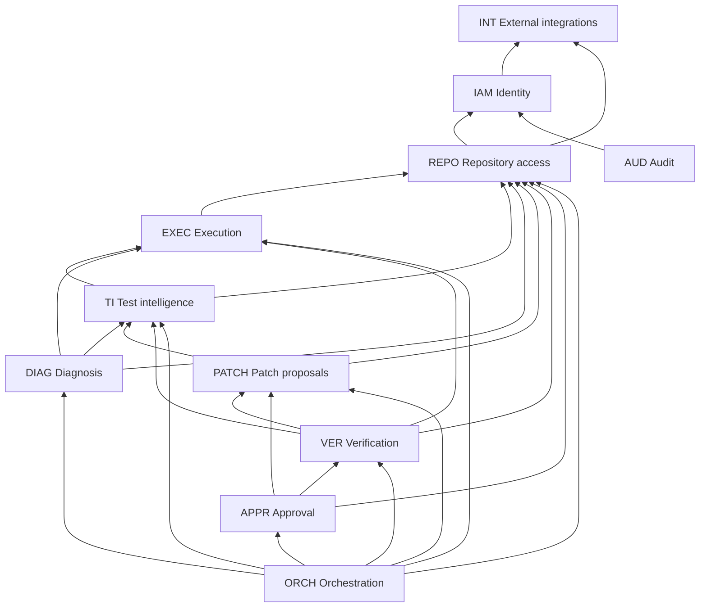

# FlakePilot — Bounded Contexts

| | |
|---|---|
| Status | **Stage 1.3**, 2026-10-20 (corrective pass applied the same day) |
| Owns | Per-context business language, invariants, contracts and failure boundaries. The context map. Validation of cross-context invariants and boundary defects |
| Defers to | Responsibilities and data owned: [DOMAIN-BOUNDARIES](DOMAIN-BOUNDARIES.md). Permitted dependencies (**the authority**): [DEPENDENCY-RULES §3.1](DEPENDENCY-RULES.md#31-matrix-rows-depend-on-columns). Runtime interactions: [SYSTEM-ARCHITECTURE §8](SYSTEM-ARCHITECTURE.md#8-workflow-interactions-aj). Product behavior: [PRODUCT-SCOPE](../product/PRODUCT-SCOPE.md). Rationale: [ADR-001](../adr/ADR-001-modular-monolith.md)–[ADR-004](../adr/ADR-004-control-plane-and-execution-plane.md) |
| Not in scope | Code, data models, API signatures, persistence, providers (all deferred, [SYSTEM-ARCHITECTURE §10](SYSTEM-ARCHITECTURE.md#10-unresolved-and-deferred-decisions)) |

The 11 bounded contexts are the 11 domains, using the codes already defined in [DOMAIN-BOUNDARIES](DOMAIN-BOUNDARIES.md). No code mapping is needed.

**Reading this document:**
- Each context follows the same template. Facts restated from the source docs are kept to the minimum needed to state boundaries.
- Rows marked **(clarification)** draw a conclusion from existing ownership rules without adding behavior.
- Anything unresolved is listed in [§6](#6-open-questions).

---

## 1. Context template

| Row | Meaning |
|---|---|
| Purpose | The business capability the context owns |
| Language | Key terms and their meaning *in this context* (homonyms across contexts: [§3](#3-terms-that-differ-across-contexts)) |
| Owns | Concepts, records, lifecycle states, and decisions the context exclusively owns |
| Invariants | Rules that must always hold |
| Accepts | Conceptual commands, with their callers |
| Exposes | Conceptual queries and read-only views, with their consumers |
| Publishes | Domain events |
| Consumes | Other contexts' APIs and events it uses |
| Depends on | Exactly the [DEPENDENCY-RULES §3.1](DEPENDENCY-RULES.md#31-matrix-rows-depend-on-columns) row |
| Excludes | What belongs elsewhere, with the owner |
| Failure boundaries | Unavailable dependencies, rejected operations, retries, inconclusive results |

---

## 2. Contexts

### IAM — Product and identity management

| Row | Content |
|---|---|
| Purpose | Who a principal is and what it may do in FlakePilot. Capacity (quotas) and the org retention policy |
| Language | **Principal**: a user, an ingestion token, or `system`. **Grant**: a per-repo capability (`repo.view`, `repo.investigate`, `repo.approve`, `repo.configure`). **Role**: platform operator or org admin. **Authorization decision**: FlakePilot grants intersected with code-host permission (PRODUCT-SCOPE §3.1). **Break-glass**: time-limited operator access to tenant content |
| Owns | See [DOMAIN-BOUNDARIES › IAM](DOMAIN-BOUNDARIES.md#iam--product-and-identity-management). Decisions: authorization, quota, grant issuance including `repo.approve` |
| Invariants | Only org admins grant `repo.approve`. Org admins don't implicitly hold it (D2). The last org admin can't be removed. Identity-provider claims are never authorization. An ingestion token is scoped to one repo and can only ingest. Operators reach tenant content only through break-glass |
| Accepts | Manage members and grants, issue or revoke ingestion tokens, set quotas, set retention policy, start or end break-glass, suspend an org (from the interface). Reserve or report quota (TI, ORCH, EXEC, DIAG, VER) |
| Exposes | Authenticate (interface). Authorize (the application layer of every context). Org member count (APPR). Retention policy (TI, EXEC, ORCH) |
| Publishes | `member.*`, `grant.issued`, `grant.revoked`, `ingestion_token.*`, `quota.changed`, `quota.denied`, `retention_policy.changed`, `break_glass.*`, `org.suspended`, `integration.config_changed`. Concrete names so far ([ADR-012](../adr/ADR-012-event-envelope-and-outbox.md)): `iam.user.signed_in`, `iam.session.created`, `iam.session.revoked`, `iam.ci_upload_token.created`, `iam.ci_upload_token.revoked`, `iam.org.bootstrapped` |
| Consumes | INT identity-provider port. `CodeHostAccessVerifier`: an inverted port that IAM defines and REPO implements ([DEPENDENCY-RULES §4](DEPENDENCY-RULES.md#4-inverted-ports-cycle-breaking)). No events |
| Depends on | INT |
| Excludes | Code-host permission facts (REPO). Investigations (ORCH), patches (PATCH), approvals (APPR). Audit records (AUD). Provider adapters (INT) |
| Failure boundaries | Identity provider `unavailable`: no new sessions. **(clarification)** If an authorization decision can't be made, access is denied; this follows from the intersection rule. Approve and apply need a live code-host check (Q6). Over quota: an explicit rejection, or `needs_input` / `quota_exceeded` for a running stage. A grant to someone lacking matching code-host access, or removing the last admin, is rejected |

### REPO — Repository access

| Row | Content |
|---|---|
| Purpose | FlakePilot's relationship with repositories on the code host: connections, versioned repo config, code-host permission semantics, reads, and the only write operations |
| Language | **Repo connection** (with states). **Installation**: a read tier, plus an optional write tier. **Repo config version**: commands, environment definitions, regression set, acceptance-criteria defaults, patch-scope rules, auto-advance policy, write-tier flag, egress allowlist, test-environment secret *references*. **Repository permission**: what the user or installation may do on the code host. It isn't a grant. **Source snapshot** at a SHA |
| Owns | See [DOMAIN-BOUNDARIES › REPO](DOMAIN-BOUNDARIES.md#repo--repository-access). States `pending_validation`, `active`, `validation_failed`, `degraded`, `disconnected`. Decisions: connection validity, code-host permission facts |
| Invariants | No merge and no push to existing branches; the port has neither operation. Branches are created only under the prefix. Writes happen only when APPR calls. Credentials never leave adapters. Execution commands come only from config versions set by `repo.configure` holders. Code-host content is untrusted data |
| Accepts | Connect, complete installation, select repos (org admin). Run validation (worker). Edit config, set a test-environment secret, write-only (`repo.configure`). Apply an approved patch (APPR only) |
| Exposes | Config version (EXEC, VER, PATCH, ORCH, APPR). Resolve SHA, check SHA reachable (TI, APPR). Source snapshot (EXEC, PATCH). File range (DIAG). Connection state (TI, ORCH, APPR). PR state. `CodeHostAccessVerifier` implementation (IAM) |
| Publishes | `repo_connection.state_changed`, `repo_config.version_created`, `installation.changed`, `integration.config_changed` |
| Consumes | IAM authorize. INT code-host port and secret port. No events |
| Depends on | IAM, INT |
| Excludes | Approval validity (APPR). Grants (IAM). Executing code (EXEC). Merging (the code host's own review). Interpreting tests (TI) |
| Failure boundaries | Code host `transient`, `rate_limited`, or `unavailable`: bounded retry. Permission errors: re-validate, then `degraded`. Uninstalled: `disconnected`. Validation failures: `validation_failed` with the missing permission named. A write rejected by branch protection: a typed error returned to APPR |

### TI — Test intelligence

| Row | Content |
|---|---|
| Purpose | Turn test results into normalized history and evidence, and make the rule-based judgments: reproduction outcome and failure classification |
| Language | **Test identity**. **Test result** (`passed`, `failed`, `errored`, `skipped`). **Run**: a normalized CI run. **Failure signature**. **Evidence bundle**: versioned, each version immutable, made of evidence IDs. **Classification**: class, reason code, rule version. **Reproduction outcome**. **Upload**: idempotency key plus content hash. **Observed failure rate** |
| Owns | See [DOMAIN-BOUNDARIES › TI](DOMAIN-BOUNDARIES.md#ti--test-intelligence). Upload states `received`, `processing`, `processed`, `rejected`, `processing_failed`. Run flag `unverified_revision`. Reproduction outcomes `reproduced`, `not_reproduced`, `different_failure`, `execution_failure`, `unsupported` (reason `missing_secrets`, among others). Classes `flaky`, `deterministic_regression`, `infrastructure_failure`, `inconclusive`, with reasons including `no_passing_baseline`, `insufficient_history`, `conflicting_signals`, `not_reproduced`, `unsupported` |
| Invariants | Classification comes only from versioned rules over execution evidence, and the same evidence always gives the same class. AI is never an input (P1). A consistent failure with no passing baseline is `inconclusive` / `no_passing_baseline` (D4). Same idempotency key and hash: no new records. Same key, different hash: rejected. Evidence versions are immutable. Outcomes are recomputed from raw outputs, never taken from sandbox summaries. TI never opens investigations (D3) |
| Accepts | Accept upload (interface, with an ingestion token). Normalize (worker). Assemble evidence and classify, evaluate reproduction (ORCH). Delete raw reports under retention (`system`) |
| Exposes | History (interface). Evidence items, read-only (DIAG, interface). Classification (PATCH, ORCH, interface). Signature match and observed failure rate (VER) |
| Publishes | `upload.received`, `upload.duplicate`, `upload.rejected`, `upload.processed`, `upload.processing_failed`, `evidence.sealed`, `reproduction.evaluated`, `classification.recorded`. Emitted so far, with the ADR-012 prefix ([ADR-013](../adr/ADR-013-stage-4-ingestion-scope-and-deviations.md)): `ti.upload.received`, `ti.upload.processed`, `ti.upload.duplicate`, `ti.upload.rejected` |
| Consumes | IAM: authorize, ingestion-token scope, quota, retention policy. REPO: connection state, SHA reachability. EXEC: run records and raw outputs, read-only. INT: CI/report port, artifact port |
| Depends on | IAM, REPO, EXEC, INT |
| Excludes | Running code (EXEC). Verification outcome (VER). Hypotheses and claims (DIAG); TI never reads them. Investigation state (ORCH). Choosing commands (REPO config) |
| Failure boundaries | Invalid upload: a synchronous rejection with reasons. Normalization failure: `processing_failed`, retried automatically, resubmission is safe. SHA check impossible: the run is flagged `unverified_revision`. Too little evidence: `inconclusive` with a reason. This is a *result*, not an error. Environment errors in EXEC runs: `execution_failure`. Missing secrets, or a test type that can't be run: `unsupported`. **(clarification)** EXEC records execution facts and TI decides outcomes. Which context detects missing secrets, and how that's recorded, is BC-Q7 |

### ORCH — Investigation orchestration

| Row | Content |
|---|---|
| Purpose | Coordinate one user-initiated investigation through its stages to a resolution. **ORCH sequences and records. It doesn't judge** |
| Language | **Investigation**. **State**: the nine states. **Stage**: `evidence`, `reproduction`, `diagnosis`, `patch`, `verification`. **Stage job**: `pending`, `running`, then `finished` (with an outcome), `errored`, or `cancelled` (PRODUCT-SCOPE Workflow D). This is ORCH machinery, not an EXEC run. **Resolution**: `patch_applied`, or `closed` with reason `infrastructure_failure`, `inconclusive`, `flaky_no_fix`, `patch_rejected`, `wont_fix`, or `other`. **Auto-advance**. **Cancellation intent** |
| Owns | See [DOMAIN-BOUNDARIES › ORCH](DOMAIN-BOUNDARIES.md#orch--investigation-orchestration). States `queued`, `running`, `needs_input`, `awaiting_approval`, `applying`, `completed`, `failed`, `cancelled`, `archived`. Stage jobs, attempts, leases, transition history. Decisions: sequencing, next stage, duplicate check (Q8), resolution |
| Invariants | ORCH is the **only writer** of investigation state. An investigation is always in exactly one state, and only the PRODUCT-SCOPE Workflow I transitions exist. Creation is user-only (D3). `applying` can't be cancelled. Transitions are compare-and-set. `failed` means control-plane failure only. ORCH never computes an outcome or approval validity. ORCH carries DIAG output only as candidate diff text to PATCH, never to TI or VER. Nothing depends on ORCH |
| Accepts | Create, start stage, submit human patch, retry, retry application, cancel, close, archive (interface). Archival by `system` under the retention policy |
| Exposes | Investigation state, stage, resolution, transition history (interface) |
| Publishes | `investigation.state_changed` |
| Consumes | Calls: IAM (authorize, quota, retention), REPO (connection state, auto-advance and write-tier config), TI (assemble/classify, evaluate reproduction), EXEC (start and cancel runs), DIAG (diagnose, generate patch candidate), PATCH (precondition decision, submit candidate, mark applied), VER (start and cancel verification), APPR (open approval request, apply, invalidate for investigation, approval status). Events: `verification.completed`, `decision.recorded`, `approval.eligibility_lost`, `application.succeeded`, `application.failed` |
| Depends on | IAM, REPO, EXEC, TI, DIAG, PATCH, VER, APPR |
| Excludes | Classification and reproduction outcome (TI). Verification outcome (VER). Approval eligibility, staleness, decisions (APPR). Patch validity (PATCH). Diagnoses and claims (DIAG). Run lifecycle (EXEC). The auto-advance *policy value* (REPO config) |
| Failure boundaries | Lease expiry: idempotent re-run, bounded, then `failed`. External-provider error after retries: `needs_input`. Quota: `needs_input` / `quota_exceeded`. Repo `degraded`: later code-host stages are blocked. Cancellation is propagated idempotently and refused in `applying`. Retry from `failed` resumes after the last completed stage |

### EXEC — Browser and code execution

| Row | Content |
|---|---|
| Purpose | Run untrusted code in the execution plane on the control plane's terms, and record exactly what came back |
| Language | **Run spec**. **Run record**: one sandboxed execution with its raw outputs. It isn't TI's normalized CI run. **Sandbox**. **Artifact manifest**: hashes, plus partial or truncated labels. **Environment fingerprint**. **Dry run** |
| Owns | See [DOMAIN-BOUNDARIES › EXEC](DOMAIN-BOUNDARIES.md#exec--browser-and-code-execution). The run lifecycle, as expressed by `run.*` events. Raw outputs. Decisions: sandbox lifecycle (provision, teardown, orphan cleanup) |
| Invariants | Commands come only from REPO config. No credentials in sandboxes. Secret values exist only inside the adapter. One sandbox per run, never reused. Teardown is idempotent, including on cancel. **Never interprets results as outcomes.** Artifacts are untrusted, size-capped, hashed, and redacted by the export adapter ([ADR-004](../adr/ADR-004-control-plane-and-execution-plane.md)) |
| Accepts | Start run, cancel run (ORCH, VER). Dry run (interface). Delete run artifacts under retention (`system`) |
| Exposes | Run records and artifacts, read-only (TI, VER, DIAG, interface) |
| Publishes | `run.requested`, `run.started`, `run.finished`, `run.errored`, `run.cancelled`, `artifacts.exported`, `artifact.deleted`, `dry_run.finished`, `integration.config_changed` |
| Consumes | IAM (authorize, sandbox quota, retention). REPO (config, source snapshot). INT (sandbox port, artifact port). No events |
| Depends on | IAM, REPO, INT |
| Excludes | Reproduction outcome and classification (TI). Verification outcome (VER). Choosing commands (REPO config). Isolation technology (the sandbox provider, through INT) |
| Failure boundaries | Sandbox `unavailable` or an environment error: recorded in the run record as an environment error, separate from test results (sandbox-port guarantee). TI and VER map it to `execution_failure`. Transient provisioning errors are retried. Oversized artifacts are truncated and marked. Cancel: teardown, with partial artifacts kept and labeled |

### DIAG — AI-assisted diagnosis

| Row | Content |
|---|---|
| Purpose | Produce AI-assisted, evidence-cited **proposals** (hypotheses and patch candidates) within the org's data policy. Never facts (P1) |
| Language | **Data-sharing policy**: `disabled`, `evidence_only`, `evidence_and_source`. **Hypothesis**. **Claim status**: `evidence_linked`, `unverified`, `contradicted`. This is a mechanical citation check, *not* truth. **Model-reported confidence**: shown only as "model-reported, uncalibrated". **Diagnosis outcome**: `produced`, `no_hypothesis`, `rejected`, `unavailable`. **Patch candidate**: raw diff text. It isn't a patch version. **Override**: choosing a hypothesis with no `evidence_linked` claim |
| Owns | See [DOMAIN-BOUNDARIES › DIAG](DOMAIN-BOUNDARIES.md#diag--ai-assisted-diagnosis). Decisions: policy enforcement, schema validity, claim statuses, diagnosis outcome |
| Invariants | DIAG is the only path to AI providers. Policy is enforced when the request is built. The default is AI disabled. No secrets in payloads. Untrusted content is delimited. No side-effect tools. Output is schema-validated. Confidence is never an input to any decision. DIAG has no command path into TI, VER, or APPR, and none of them can read DIAG |
| Accepts | Diagnose, generate patch candidate (ORCH). Set policy, provider, and credentials (interface, org admin) |
| Exposes | Diagnosis, read-only (interface only) |
| Publishes | `ai_request.sent`, `diagnosis.recorded`, `patch_candidate.generated`, `override.recorded`, `integration.config_changed`. Emitted so far, with the ADR-012 prefix ([ADR-014](../adr/ADR-014-stage-5-ai-platform-and-deviations.md)): `diag.ai_policy.updated`, `diag.ai_request.sent`, `diag.diagnosis.recorded` |
| Consumes | IAM (authorize, AI-spend quota). REPO (file ranges, source excerpts). EXEC (artifact excerpts, read-only). TI (evidence, read-only). INT (AI port, secret port, health). No events |
| Depends on | IAM, REPO, EXEC, TI, INT |
| Excludes | Classification (TI). Verification outcome (VER). Approval (APPR). Patch validity (PATCH). State transitions (ORCH). Model inference (the provider) |
| Failure boundaries | Policy `disabled`, no provider, or an unhealthy provider: `unavailable`, and the core still works (P6). Malformed output after bounded retries: `rejected`. Provider errors after retries: the job is `errored`, then ORCH `needs_input`. Quota: `quota_exceeded`. Injected instructions in the output have no effect. Cancel: the call is abandoned, cost is recorded, and nothing is stored as a hypothesis |

### PATCH — Patch proposals

| Row | Content |
|---|---|
| Purpose | Turn a candidate diff (AI or human) into an immutable, validated patch version bound to a base SHA |
| Language | **Patch version**: diff, diff hash, base SHA, provenance `ai` or `human`. **Validity**: `valid` or `invalid` with reasons. **Masking label**. **Superseded**. **Applied**. **Precondition**: a classification gate, with an audited `inconclusive` override. **Hypothesis reference**: opaque |
| Owns | See [DOMAIN-BOUNDARIES › PATCH](DOMAIN-BOUNDARIES.md#patch--patch-proposals). States `validating`, `valid`, `invalid`, `superseded`, `applied`. Decisions: validity, masking label, precondition. **(clarification)** PATCH also owns the record of the `inconclusive` precondition override, because it owns the precondition check (BC-Q3) |
| Invariants | An `invalid` patch is never verified. Every change creates a new version, and the previous valid version becomes `superseded`. Identity is diff hash + base SHA + provenance. Precondition: `flaky` or `deterministic_regression`; `inconclusive` only with an override; never `infrastructure_failure`. Masking is rejected by default, or labeled if policy allows. Validation is a text operation: no execution. PATCH never calls AI or DIAG and never exposes hypothesis content |
| Accepts | Submit candidate (ORCH). Mark applied (ORCH only). Export (interface) |
| Exposes | Classification-precondition decision (ORCH, before an AI candidate is requested; PRODUCT-SCOPE Workflow F preconditions, BC-Q2). Patch: diff, hash, base SHA, validity, masking label, human author (VER, APPR, interface) |
| Publishes | `patch_version.created`, `patch.validated`, `patch.superseded`, `patch.applied` |
| Consumes | IAM (authorize). REPO (snapshot, scope rules). TI (classification). No events |
| Depends on | IAM, REPO, TI |
| Excludes | Generating candidates (DIAG, or a human). Building and testing (VER through EXEC). Approval (APPR). Writing to the code host (APPR through REPO) |
| Failure boundaries | Validation failure: `invalid` with reasons, never verified. Base SHA unreachable: ORCH `needs_input`, and a new target revision is needed. Cancel during validation: no version is created |

### VER — Verification

| Row | Content |
|---|---|
| Purpose | Decide, from execution evidence and frozen criteria only, whether a patch met its acceptance criteria |
| Language | **Acceptance-criteria snapshot**: N_b, N_p, regression set, timeouts, confounding rule. Frozen, and overrides may only make it stricter (Q9). **Baseline, patched, and regression phases**. **Verification outcome**. Reason codes `baseline_not_reproduced`, `insufficient_runs_possible`, `confounded`. **Superseded verification**. **"Verified"** means it met the criteria, not that the patch is correct |
| Owns | See [DOMAIN-BOUNDARIES › VER](DOMAIN-BOUNDARIES.md#ver--verification). Outcomes `verified_pass`, `verified_failure`, `inconclusive`, `execution_failure`. Decisions: the outcome, N_p, supersession |
| Invariants | The outcome is a function of run records and the snapshot only, with no DIAG input. The baseline must reproduce the failure. Every one of the N_p patched runs must pass. A new regression failure gives `verified_failure`. A per-test timeout counts as a failing run. Environment errors give `execution_failure`. The snapshot never changes after the start. One passing run is never enough (P2). A new verification supersedes the earlier one |
| Accepts | Start, cancel (ORCH) |
| Exposes | Latest non-superseded verification for a patch (APPR, ORCH, interface) |
| Publishes | `verification.started`, `verification.completed`, `verification.superseded`, `verification.cancelled` |
| Consumes | IAM (authorize, quota). REPO (config). EXEC (runs). TI (signature match, observed failure rate). PATCH (diff, validity). No events |
| Depends on | IAM, REPO, EXEC, TI, PATCH |
| Excludes | Running code (EXEC). Signatures and classification (TI). Approval (APPR). Patch validity (PATCH). Diagnosis (DIAG); there is no path to it |
| Failure boundaries | Evidence can't decide: `inconclusive` with a reason (a result). Environment errors that persist after bounded in-phase retries: `execution_failure`, which can be retried. Cancel: no outcome. On resume, completed phases aren't rerun |

### APPR — Human approval

| Row | Content |
|---|---|
| Purpose | Record and honor human decisions on verified patches |
| Language | **Approval request**: opened by ORCH, carrying the investigation creator. **Decision**: `approve` / `reject`, immutable. **Approval**: `active`, `consumed`, `invalidated`. **Eligibility**. **Staleness trigger**. **Target-branch drift**: *not* a trigger (D1). **Application**: recheck, write through REPO, consume. **Separation of duties** (D2) |
| Owns | See [DOMAIN-BOUNDARIES › APPR](DOMAIN-BOUNDARIES.md#appr--human-approval). Decisions: eligibility, staleness and invalidation, whether an approval may be honored, the application-attempt result |
| Invariants | Only a `verified_pass` (latest, non-superseded) of a `valid`, non-superseded patch can be approved. Approving needs `repo.approve` plus live code-host write. Rejecting needs `repo.approve` only. D2: self-approval only in single-member orgs. Masking labels must be acknowledged. Approval is bound to patch version and diff hash, base SHA, verification, criteria snapshot hash, config version, and policy version (BC-Q6). Every PRODUCT-SCOPE Workflow H trigger invalidates; drift doesn't (D1). Application only cuts a branch from the base SHA under the prefix and opens a PR. **It never merges.** Idempotent per approval ID |
| Accepts | Approve, reject (interface). Open approval request, apply, invalidate for investigation (ORCH) |
| Exposes | Eligibility and approval status (ORCH, interface) |
| Publishes | `approval_request.opened`, `decision.recorded`, `approval.invalidated`, `approval.eligibility_lost`, `application.attempted`, `application.succeeded`, `application.failed`, `approval.consumed` |
| Consumes | Calls: IAM (authorize, member count), REPO (write operation, SHA reachability), PATCH (state, author, masking label), VER (latest outcome). Events: `grant.revoked`, `repo_config.version_created`, `repo_connection.state_changed`, `patch_version.created`, `verification.superseded` |
| Depends on | IAM, REPO, PATCH, VER |
| Excludes | Merging (the code host). Investigation state (ORCH). Executing the code-host write (REPO). Verification (VER). Diagnosis or confidence (DIAG); there is no path to it |
| Failure boundaries | Stale: `invalidated`. Branch protection blocks the write: application `failed`, approval stays `active`. Write permission lost: application `failed`, approval `invalidated`, and REPO marks the repo `degraded`. Partial or transient failure: idempotent resume, bounded. **(clarification)** If the live authorization check can't complete, approve and apply are denied |

### INT — External integrations

| Row | Content |
|---|---|
| Purpose | Vendor-neutral port contracts and adapters for every external provider ([ADR-003](../adr/ADR-003-provider-adapters.md)) |
| Language | **Port contract**. **Adapter**. **Conformance suite**. **Fake**. **Credential reference**. **Typed error**: `transient`, `rate_limited`, `permission_denied`, `not_found`, `conflict`, `invalid_request`, `quota_exceeded`, `unavailable`. **Health** |
| Owns | See [DOMAIN-BOUNDARIES › INT](DOMAIN-BOUNDARIES.md#int--external-integrations). Credential references, adapter health status |
| Invariants | A leaf: INT depends on no context. No business rules. Never called by the interface layer. No user-facing use cases. Secret values are resolved only inside adapters. Structural guarantees hold, such as no merge operation and write-only secrets ([SYSTEM-ARCHITECTURE §4](SYSTEM-ARCHITECTURE.md#4-ports-architectural-interfaces)) |
| Accepts | Port operations from the application layers of the contexts that use them |
| Exposes | Health status (to the contexts that use it) |
| Publishes | `integration.health_changed` |
| Consumes | External providers only |
| Depends on | — |
| Excludes | Integration configuration use cases (consuming contexts). Data policy (DIAG). Authorization (IAM). Records stored through ports (their writers) |
| Failure boundaries | Returns typed errors only. Retry and `needs_input` / `failed` mapping happens in the calling context ([SYSTEM-ARCHITECTURE §5](SYSTEM-ARCHITECTURE.md#5-cross-cutting-runtime-mechanisms)). An unhealthy adapter makes the consumer report `unavailable` |

### AUD — Audit and observability

| Row | Content |
|---|---|
| Purpose | The append-only audit trail, plus observability derived from every event envelope |
| Language | **Audit record**: the envelope fields (actor, action, target, before/after, reason, correlation ID, timestamp). **Correlation ID**. **Metric**: derived from envelope after-state values. **Export** |
| Owns | See [DOMAIN-BOUNDARIES › AUD](DOMAIN-BOUNDARIES.md#aud--audit-and-observability). Audit records, metric aggregates |
| Invariants | Append-only, and nobody edits records, operators included. AUD reads only the shared-kernel envelope. No context depends on AUD. Audit intent is committed in the originating transaction through the outbox (fail closed). Queries are tenant-filtered and authorized through IAM |
| Accepts | Export (interface: org admin) |
| Exposes | Audit query (org admin; `repo.view` for a repo's trail). Metrics and correlation views (operators get metadata only) |
| Publishes | `audit.exported` |
| Consumes | IAM (authorize). Every event envelope, through the shared kernel |
| Depends on | IAM |
| Excludes | Every context's business state. Interpreting payloads. Storage backends (delegated) |
| Failure boundaries | If the outbox write fails, the originating action aborts. That's the originator's transaction, not an AUD call. Appending is at least once and deduped by event ID. A failed export is retried, and no partial export becomes visible |

---

## 3. Terms that differ across contexts

| Term | Meaning per context |
|---|---|
| Run | **TI**: a normalized CI run that was ingested. **EXEC**: a run record of one sandboxed execution. PRODUCT-SCOPE's glossary defines both under one word, but they are different records with different owners |
| `inconclusive` | **TI**: a classification class with a reason code. **VER**: a verification outcome with a reason code. **ORCH**: a `closed` resolution reason |
| `execution_failure` | The same meaning (the environment couldn't produce valid evidence), but separate records: a TI reproduction outcome and a VER verification outcome |
| `active` | **REPO**: a connection state. **APPR**: an approval state |
| Reject / `rejected` | **TI**: an upload state. **DIAG**: a diagnosis outcome (malformed AI output). **APPR**: the decision `reject` |
| Failed | **ORCH** `failed`: control-plane failure of an investigation. **APPR**: an application attempt failed. **REPO** `validation_failed`. **TI** `processing_failed` |
| `unavailable` | **DIAG**: a diagnosis outcome. **INT**: a typed error |
| `quota_exceeded` | **INT**: a typed error. **ORCH**: a `needs_input` reason. The quota decision itself is IAM's |
| Cancelled | **ORCH**: an investigation state and a stage-job state. **EXEC**: a run event. **VER**: a verification left without an outcome |
| Superseded | **PATCH**: an older patch version. **VER**: an older verification of the same patch |
| Override | **DIAG**: choosing a hypothesis with no `evidence_linked` claim. **PATCH**: the `inconclusive` precondition override. **VER**: a per-request criteria override, stricter only (Q9) |
| Policy | **DIAG**: the data-sharing policy. **IAM**: the retention policy. **REPO**: patch-scope and masking rules in repo config. **APPR**: the "policy version" on the approval record, whose referent is unspecified (BC-Q6) |
| Job | **ORCH**: a stage job. Other contexts run internal jobs (TI normalization, REPO validation), but they aren't investigation stage jobs |
| Artifact | **EXEC**: run artifacts. **TI**: raw-report artifacts. Both are stored through the INT artifact port and owned by their writer |
| Verified | **VER**: `verified_pass` means "met the recorded criteria". **PATCH**: an export labeled verified, which carries the same meaning |

---

## 4. Context map

### 4.1 Diagram

The authority for which cross-context dependencies are allowed is the [DEPENDENCY-RULES §3.1 matrix](DEPENDENCY-RULES.md#31-matrix-rows-depend-on-columns). Arrows point from the dependent context to the context it depends on.

This has the same 26 edges as the [DEPENDENCY-RULES §3.2](DEPENDENCY-RULES.md#32-graph) graph. **Edges left out for readability** (all present in the matrix):
- To IAM from EXEC, TI, DIAG, PATCH, VER, APPR, and ORCH.
- To INT from EXEC, TI, and DIAG.

AUD's consumption of every event envelope goes through the shared kernel and is not a context edge.

### 4.2 Sync application calls vs async domain events

| Mode | Mechanism | Direction rule |
|---|---|---|
| **Sync** | A caller invokes another context's public application API (command or query). One context per transaction | Allowed only along matrix edges (caller → callee) |
| **Async** | The publisher writes an event to the outbox in the same transaction. Subscribers consume it at least once, deduped by event ID ([SYSTEM-ARCHITECTURE §5](SYSTEM-ARCHITECTURE.md#5-cross-cutting-runtime-mechanisms)) | The subscriber must have a matrix edge to the publisher. The one exception is AUD, which reads only the envelope ([DEPENDENCY-RULES](DEPENDENCY-RULES.md)) |
| **Inverted port** | `CodeHostAccessVerifier`, defined by IAM and implemented by REPO | The compile-time edge is REPO → IAM. At runtime IAM calls the implementation |

Documented event subscriptions (from [SYSTEM-ARCHITECTURE §8](SYSTEM-ARCHITECTURE.md#8-workflow-interactions-aj)):

| Subscriber | Publisher | Events |
|---|---|---|
| APPR | IAM | `grant.revoked` |
| APPR | REPO | `repo_config.version_created`, `repo_connection.state_changed` |
| APPR | PATCH | `patch_version.created` |
| APPR | VER | `verification.superseded` |
| ORCH | VER | `verification.completed` |
| ORCH | APPR | `decision.recorded`, `approval.eligibility_lost`, `application.succeeded`, `application.failed` |
| AUD | every context, envelope only | every event |

### 4.3 Who owns each transition and decision

| Transition / decision | Owner | Who may only trigger or relay it |
|---|---|---|
| Investigation state transitions, stage, resolution, next stage, duplicate check | ORCH | User commands, and events from VER and APPR |
| Repo connection transitions, config versions, code-host permission facts | REPO | Code-host webhooks (through the interface), APPR (write call) |
| Authorization, grants including `repo.approve` (D2), quotas, retention policy, break-glass | IAM | — |
| Upload states, deduplication, evidence sealing, reproduction outcome, classification | TI | ORCH (requests), EXEC (supplies raw facts) |
| Run lifecycle, sandbox provision and teardown | EXEC | ORCH and VER (start and cancel) |
| Policy enforcement, schema validity, claim statuses, diagnosis outcome, hypothesis override | DIAG | ORCH (requests) |
| Patch version states, validity, masking label, classification precondition (including the `inconclusive` override) | PATCH | ORCH (asks for the precondition decision before an AI candidate, submits, marks applied after APPR succeeds) |
| Criteria snapshot, verification outcome, supersession | VER | ORCH (start and cancel) |
| Eligibility, decisions, approval states, staleness and invalidation, honoring an approval, application result | APPR | Interface (decisions), ORCH (apply, invalidate on cancel) |
| Executing the branch, commit, and PR write | REPO | APPR only |
| Deleting owned artifacts | TI (raw reports), EXEC (run artifacts) | `system` under the IAM retention policy |
| Archival | ORCH | User or `system` |
| Adapter health | INT | — |
| Audit append | AUD | Every context, through the outbox envelope |

**ORCH's role:** it coordinates, sequences, and is the only writer of investigation state. It reads other contexts' outcomes (`verification.completed`, `decision.recorded`, and so on) to choose its *own* transition. It never computes a classification, reproduction outcome, verification outcome, patch validity, claim status, or approval eligibility ([DOMAIN-BOUNDARIES › ORCH](DOMAIN-BOUNDARIES.md#orch--investigation-orchestration)).

### 4.4 How boundaries hold in one monolith

- **One deployable**, with modules that own their data and expose only public APIs ([ADR-001](../adr/ADR-001-modular-monolith.md)). Per-context layering, a fixed acyclic matrix, and automated boundary checks ([ADR-002](../adr/ADR-002-domain-layering.md), [DEPENDENCY-RULES §7](DEPENDENCY-RULES.md#7-enforcement)).
- **Providers sit behind INT-owned ports and adapters.** Business contexts see only vendor-neutral contracts and credential references ([ADR-003](../adr/ADR-003-provider-adapters.md)).
- **The untrusted execution plane is separate from the trusted control plane.** EXEC drives sandboxes through the sandbox port, and TI and VER treat everything returned as claims to recompute ([ADR-004](../adr/ADR-004-control-plane-and-execution-plane.md), [SYSTEM-ARCHITECTURE §3](SYSTEM-ARCHITECTURE.md#3-control-plane-vs-execution-plane)).

---

## 5. Validation

**Method key:** **S** = scripted check (run for this document; results reported with Stage 1.3). **M** = manual review against the cited sources.

### 5.1 Invariant checks

| # | Invariant | Verdict | Method | Sources |
|---|---|---|---|---|
| I1 | DIAG can't determine classification, verification outcomes, approval eligibility, or investigation state transitions | **Holds** | S (reachability), M | DEPENDENCY-RULES §5; DOMAIN-BOUNDARIES › DIAG "Must not"; PRODUCT-SCOPE P1, §5.1, §5.3 |
| I2 | PATCH receives AI candidate diffs only through ORCH, and validates them | **Holds** | M | SYSTEM-ARCHITECTURE §8 F steps 1a–3; DEPENDENCY-RULES §4; DOMAIN-BOUNDARIES › PATCH "Must not call AI providers or DIAG" |
| I3 | TI, VER, APPR (and PATCH) don't depend on DIAG, directly or transitively | **Holds** | S | DEPENDENCY-RULES §3.1, §5 |
| I4 | AI confidence is never exposed as a calibrated fact | **Holds** | M | PRODUCT-SCOPE §5.3; DOMAIN-BOUNDARIES › DIAG; SYSTEM-ARCHITECTURE §4 AI port ("never relies on … calibrated confidence") |
| I5 | ORCH is the only writer of investigation state. Others own their outcomes and records | **Holds** | M | DOMAIN-BOUNDARIES › ORCH; SYSTEM-ARCHITECTURE §8 I; §4.3 above |
| I6 | Investigation creation is user-initiated only (D3) | **Holds** | M | PRODUCT-SCOPE D3, Workflow C, Workflow I auto-advance; SYSTEM-ARCHITECTURE §8 C step 1; DOMAIN-BOUNDARIES › TI "Must not … open investigations" |
| I7 | VER computes outcomes from execution evidence and the frozen criteria only | **Holds** | M | PRODUCT-SCOPE Workflow G step 5; SYSTEM-ARCHITECTURE §8 G; DOMAIN-BOUNDARIES › VER |
| I8 | APPR owns eligibility, decisions, and staleness. Approval is tied to the exact patch, base SHA, and verification. Applying never merges | **Holds** | M | PRODUCT-SCOPE Workflow H, §3.1, P3, §9; SYSTEM-ARCHITECTURE §4 code-host port (no merge operation); DOMAIN-BOUNDARIES › APPR |
| I9 | REPO owns repo config and code-host access semantics | **Holds** | M | PRODUCT-SCOPE §8; DOMAIN-BOUNDARIES › REPO and §2 index; ADR-003 decision 2 |
| I10 | EXEC owns the execution lifecycle and raw run records, not outcomes | **Holds** | M | PRODUCT-SCOPE §8 (EXEC "Doesn't own … interpreting run results as outcomes"); DOMAIN-BOUNDARIES › EXEC; ADR-004 decision 5 |
| I11 | Untrusted code never runs in the control plane | **Holds** | M | ADR-004 decision 1; SYSTEM-ARCHITECTURE §3.2 rule 6; PRODUCT-SCOPE §9 |
| I12 | Secrets and credentials follow ADR-003 and ADR-004 (values only in adapters or the sandbox; references elsewhere) | **Holds** | M | ADR-003 decision 4; ADR-004 decision 3; SYSTEM-ARCHITECTURE §7.4; PRODUCT-SCOPE §4, §8 |
| I13 | AUD keeps audit and observability without owning others' business state | **Holds** | M | DOMAIN-BOUNDARIES › AUD; DEPENDENCY-RULES (envelope exception, §2 rule 5) |
| I14 | INT owns provider contracts and adapters. Consumers keep semantics and records | **Holds** | M | ADR-003 decisions 1–2; PRODUCT-SCOPE §8; DOMAIN-BOUNDARIES › INT |
| I15 | D1–D4 and P1–P8 are preserved as written | **Holds**: this document cites them and doesn't restate or change them | S (source files unchanged), M | PRODUCT-SCOPE §1, §11 |

### 5.2 Boundary defect checks

| # | Check | Result | Method |
|---|---|---|---|
| B1 | The same concept owned by more than one context | **None found.** Homonyms (§3) are distinct concepts with separate owners. Two splits were made explicit: ORCH stage job vs EXEC run vs VER verification record, and TI vs VER `execution_failure` | M |
| B2 | A context making another context's decision | **No contradiction remains.** One wording defect was found and corrected in the corrective pass: SYSTEM-ARCHITECTURE §8 J read as if EXEC marks TI's evidence. It now says TI does (BC-Q5). ORCH reads outcomes but decides only its own transitions. APPR asks REPO to write but decides validity itself. EXEC reports facts, and TI/VER decide outcomes | M |
| B3 | Ambiguous ownership of transitions, records, or events | **No contradiction. Open gaps are tracked, not resolved**: BC-Q3 (the event auditing PATCH's `inconclusive` override), BC-Q4 (TI's raw-report deletion event), and BC-Q5 (how TI marks evidence removed after EXEC deletes an artifact). Record ownership is clear in each case | M |
| B4 | Cross-context dependencies that violate the matrix | **None.** Each context's "Depends on" row matches the matrix row. Every documented subscription follows a matrix edge | S |
| B5 | Cycles or undocumented dependencies | **None.** Acyclic. The only inverted port is documented | S |
| B6 | Provider-specific types leaking into business contexts | **None found** (no vendor or product names in context definitions) | S (keyword scan), M |
| B7 | Responsibilities with no owner | **No unowned responsibility** (DOMAIN-BOUNDARIES §2, PRODUCT-SCOPE §8). One undefined referent is tracked, not resolved: "policy version" on the approval record (BC-Q6) | M |
| B8 | Duplicate or contradictory definitions across product scope, context map, and architecture docs | **No contradiction remains.** One omission was corrected in the corrective pass: SYSTEM-ARCHITECTURE §8 F didn't show PATCH's precondition decision coming before AI candidate generation, which PRODUCT-SCOPE Workflow F requires (BC-Q2). One gap is tracked: "INT (health)" in SYSTEM-ARCHITECTURE §8 J names the data owner, not a call path (BC-Q1) | M |

---

## 6. Open questions

None of these block Stage 1.3. None changes behavior, ownership, permitted dependencies, D1–D4, or P1–P8. Existing Q5–Q12 are unchanged ([PRODUCT-SCOPE §11](../product/PRODUCT-SCOPE.md#open-questions)), except Q10, which is now confirmed decision D6 in `PRODUCT-SCOPE.md` ([Confirmed decisions](../product/PRODUCT-SCOPE.md#confirmed-decisions)).

**Disposition key:**
- **Resolved**: follows unambiguously from a confirmed decision or documented constraint.
- **Deferred**: needs an API, event, data-model, or implementation decision that hasn't been made.
- **Blocked**: sources contradict each other. None are blocked.

The repo docs name no stages after Stage 1.3, so deferred items are assigned to a *design area*, not a stage. "Data model" is the design-area name PRODUCT-SCOPE §11 already uses.

| ID | Question | Disposition | Rationale and sources | Assigned to |
|---|---|---|---|---|
| BC-Q1 | Which route shows adapter health to operators and admins? | **Deferred** | The permitted routes follow from existing rules. The interface layer calls only context application APIs, never INT (SYSTEM-ARCHITECTURE §2; DEPENDENCY-RULES §1). INT exposes health only to the application layers of the contexts that use it (DOMAIN-BOUNDARIES › INT), and publishes `integration.health_changed`, which AUD records like every envelope (SYSTEM-ARCHITECTURE §5). No doc chooses which route serves the view. "INT (health)" in SYSTEM-ARCHITECTURE §8 J names the data owner, not a call path. No interface → INT edge is allowed | Later interface/API design (stage not yet planned in repo docs) |
| BC-Q2 | Must ORCH get PATCH's classification-precondition decision before asking DIAG for an AI candidate? | **Resolved: yes** | PRODUCT-SCOPE Workflow F lists the classification gate as a *precondition* of the workflow, before step 1 (candidate generation). PATCH owns the precondition (DOMAIN-BOUNDARIES › PATCH; PRODUCT-SCOPE §8). The ORCH → PATCH edge already exists (DEPENDENCY-RULES §3.1). ORCH asks and doesn't apply the rule itself. Changes: SYSTEM-ARCHITECTURE §8 F step 1a, DOMAIN-BOUNDARIES › PATCH public API (conceptual operation only), and this document's PATCH and ORCH rows. The operation's shape is left to API design | — |
| BC-Q3 | Which event audits PATCH's `inconclusive` precondition override? | **Deferred** | No PATCH event in DOMAIN-BOUNDARIES › PATCH is defined to carry it. PRODUCT-SCOPE Workflow F audit lists "overrides" separately from "validation result". After BC-Q2, for an AI patch the override is given before any patch version exists, so `patch.validated` isn't implied. Audit needs a PATCH-published envelope (SYSTEM-ARCHITECTURE §5). DIAG's `override.recorded` belongs to DIAG and covers only the hypothesis override. The event name and payload haven't been decided | Later event-contract design (stage not yet planned in repo docs) |
| BC-Q4 | Which event audits TI's raw-report deletion? | **Deferred** | DOMAIN-BOUNDARIES lists `artifact.deleted` under EXEC only. TI's events include no deletion event. PRODUCT-SCOPE Workflow J requires every deletion batch to be audited. Reusing `artifact.deleted` for TI without a contract would give two publishers one event name. SYSTEM-ARCHITECTURE §8 J now marks TI's event as not yet named | Later event-contract design (stage not yet planned in repo docs) |
| BC-Q5 | How does TI mark evidence items removed after EXEC deletes a run artifact? | **Deferred** | Constraints: sealed evidence versions are immutable (PRODUCT-SCOPE glossary; DOMAIN-BOUNDARIES › TI). Deleted items must be "marked as removed in evidence" (PRODUCT-SCOPE Workflow J). Only TI writes evidence (DEPENDENCY-RULES §2 rule 1), and EXEC can't call TI (§3.1). **Criteria for the choice:** keep sealed versions immutable; be idempotent; cover both TI raw reports and EXEC run artifacts; add no matrix edge. An event-driven approach would depend on BC-Q4 and EXEC's deletion contract. A read-time approach would rely on an artifact-port lookup. Either fits the direction rules, so the choice is a data-model decision | Data model (design area in PRODUCT-SCOPE §11; no stage assigned) |
| BC-Q6 | Which policy does "policy version" on the approval record refer to? | **Deferred** | The only source is PRODUCT-SCOPE Workflow H ("…repo-config version, policy version"). No architecture doc defines it. Several policies exist (DIAG data-sharing, IAM retention, REPO patch-scope and masking rules inside repo config), but none is identified. The staleness table has no policy trigger beyond repo-config scope and criteria changes. Leaving it open avoids inventing a policy type or a new staleness trigger. Staleness rules are unchanged | Data model (design area in PRODUCT-SCOPE §11; no stage assigned) |
| BC-Q7 | How are "couldn't start" execution facts, such as missing secrets, represented and detected? | **Deferred** | Three things are already distinct: (1) **typed port errors** from INT (`unavailable` and the rest), which the caller retries (SYSTEM-ARCHITECTURE §4, §5); (2) **execution facts** in EXEC run records, which keep environment errors separate from test results (SYSTEM-ARCHITECTURE §4 sandbox guarantees; DOMAIN-BOUNDARIES › EXEC); (3) **outcomes** decided by TI (`execution_failure`, `unsupported` / `missing_secrets`, per PRODUCT-SCOPE §5.2 and Workflow D) and by VER. PRODUCT-SCOPE Workflow D makes missing secrets a precondition that gives `unsupported` / `missing_secrets`, and SYSTEM-ARCHITECTURE §8 D says this is decided before provisioning. Which context detects the missing references, and how the fact is stored, isn't established. No new state is added | Data model (design area in PRODUCT-SCOPE §11; no stage assigned) |

---

## 7. Follow-ups

**Done in the corrective pass:**
- Links to this document from DOMAIN-BOUNDARIES and SYSTEM-ARCHITECTURE.
- BC-Q2 resolution: SYSTEM-ARCHITECTURE §8 F step 1a, plus the PATCH public API in DOMAIN-BOUNDARIES.
- SYSTEM-ARCHITECTURE §8 J retention wording: TI marks evidence, and TI's deletion event is marked not yet named.

**Deferred, not done:**
- After event-contract design settles BC-Q3 and BC-Q4, add the resulting event names under PATCH and TI in DOMAIN-BOUNDARIES. Until then, event definitions stay unchanged.
- BC-Q1, BC-Q5, BC-Q6, BC-Q7: carry forward to the design areas listed in §6.
