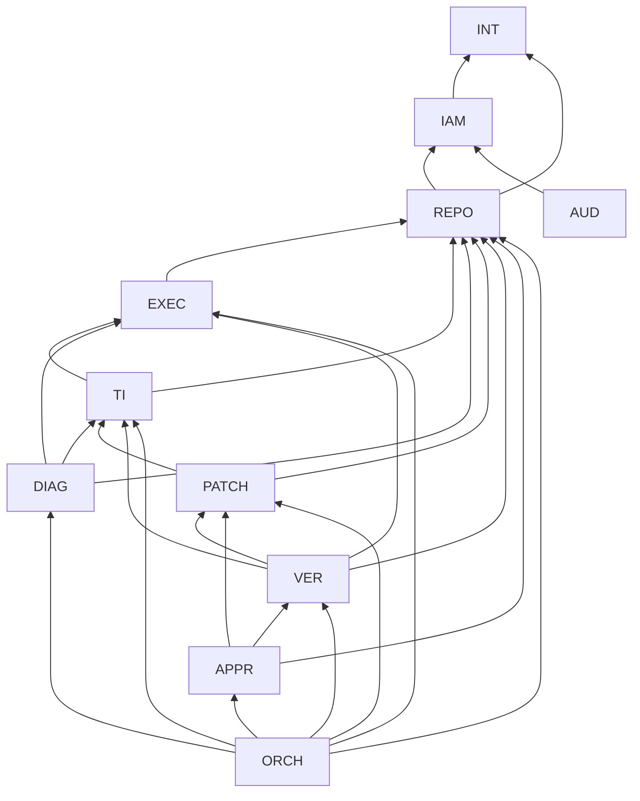

# FlakePilot — Dependency Rules

| | |
|---|---|
| Status | **Stage 1.2 complete**, 2026-10-20. ADR-001 to ADR-004 accepted by the project owner |
| Owns | Layer direction, import rules, the domain dependency matrix and graph, cycle-breaking ports, the diagnosis isolation invariant, shared-kernel rules, enforcement |
| Defers to | Domain responsibilities: [DOMAIN-BOUNDARIES.md](DOMAIN-BOUNDARIES.md). Rationale: [ADR-002](../adr/ADR-002-domain-layering.md), [ADR-003](../adr/ADR-003-provider-adapters.md) |

"A → B" means A depends on B: A calls B's public application API, uses B's port contracts, or consumes B's publisher-specific event contracts. **Consuming a publisher's event is a dependency on that publisher**, so event subscriptions follow the same graph.

One exception: AUD reads only the generic shared-kernel envelope (actor, action, target, before/after state values, reason, correlation ID). That is a dependency on the shared kernel, not on publishers. AUD derives audit records and metrics, including outcome counts from after-state values, from envelope fields alone, and it never imports publisher event contracts.

---

## 1. Layers (inside each domain)

| Layer | Contains | May depend on | Must not depend on |
|---|---|---|---|
| **Domain** | Entities, value objects, state machines, pure rules (classification rules, outcome computation, staleness rules, validation rules) | Shared kernel only | Application, infrastructure, interface. Any framework, ORM, HTTP, SDK, AI provider, vendor type, I/O, clock (injected through the shared kernel) |
| **Application** | Use cases (commands and queries), **authorization enforcement point**, transactions, outbox writes, port usage | Own domain layer. Own persistence port. INT port contracts. Other domains' **public application APIs and event contracts** (allowed by §3). Shared kernel | Any infrastructure. Any vendor. Other domains' domain or infrastructure layers |
| **Infrastructure** | Persistence implementations for this domain. INT: vendor adapters | Own application and domain layers (implements their ports). Vendor libraries (adapters only) | Other domains' infrastructure. The interface layer |
| **Interface** (system-wide) | HTTP/UI backend, ingestion endpoint, webhook receiver, worker entry points, composition root (wiring) | Domains' public application APIs (never INT). Composition root may see every infrastructure layer for wiring only | Domain internals. Making authorization decisions (it authenticates only) |

Direction: **interface → application → domain**, with **infrastructure → application/domain** (dependency inversion). Domain code compiles and is testable with no vendor, framework, or provider present.

---

## 2. Cross-domain rules

1. Cross-domain access goes **only** through the target's public application API or its published event contracts. No reading another domain's persistence. No joins across domains. No importing another domain's entities.
2. Data crosses domains as IDs plus read-only views defined in the publisher's API. Never as shared mutable objects.
3. One domain per transaction. Cross-domain effects are events (outbox) or synchronous queries ([SYSTEM-ARCHITECTURE §5](SYSTEM-ARCHITECTURE.md#5-cross-cutting-runtime-mechanisms)).
4. Events carry no secret values and no raw untrusted content, only references.
5. Writing to the audit log is never a direct call. AUD consumes the shared-kernel event envelope, so no domain depends on AUD and AUD depends on no publisher.
6. The interface layer may compose several domains' **query** APIs for display (for example, a diagnosis next to a patch). That composition can't feed one domain's data into another domain's command. Every command input follows §3.

---

## 3. Domain dependency graph

### 3.1 Matrix (rows depend on columns)

| ↓ depends on → | INT | IAM | REPO | AUD | EXEC | TI | DIAG | PATCH | VER | APPR | ORCH |
|---|---|---|---|---|---|---|---|---|---|---|---|
| **INT** | | | | | | | | | | | |
| **IAM** | ✓ | | | | | | | | | | |
| **REPO** | ✓ | ✓ | | | | | | | | | |
| **AUD** | | ✓ | | | | | | | | | |
| **EXEC** | ✓ | ✓ | ✓ | | | | | | | | |
| **TI** | ✓ | ✓ | ✓ | | ✓ | | | | | | |
| **DIAG** | ✓ | ✓ | ✓ | | ✓ | ✓ | | | | | |
| **PATCH** | | ✓ | ✓ | | | ✓ | | | | | |
| **VER** | | ✓ | ✓ | | ✓ | ✓ | | ✓ | | | |
| **APPR** | | ✓ | ✓ | | | | | ✓ | ✓ | | |
| **ORCH** | | ✓ | ✓ | | ✓ | ✓ | ✓ | ✓ | ✓ | ✓ | |

36 edges. Anything not marked is **forbidden**.

Why each edge exists:
- **INT:** depends on nothing.
- **IAM → INT:** identity-provider port.
- **REPO → IAM:** authorization. **REPO → INT:** code-host port, secret port.
- **AUD → IAM:** authorizing audit queries.
- **EXEC → IAM:** sandbox quota and authorization. **EXEC → REPO:** config, source snapshot. **EXEC → INT:** sandbox port, artifact port.
- **TI → IAM:** ingestion tokens, quota, authorization. **TI → REPO:** repo state, SHA check. **TI → EXEC:** raw run outputs for reproduction evaluation. **TI → INT:** CI/report port, artifact port.
- **DIAG → IAM:** AI spend, authorization. **DIAG → REPO:** source excerpts, citation checks. **DIAG → EXEC:** artifact excerpts. **DIAG → TI:** evidence, read-only. **DIAG → INT:** AI port, secret port.
- **PATCH → IAM:** authorization. **PATCH → REPO:** snapshot, scope rules. **PATCH → TI:** classification precondition.
- **VER → IAM:** quota, authorization. **VER → REPO:** config. **VER → EXEC:** runs. **VER → TI:** signature match, failure rate. **VER → PATCH:** diff and validity.
- **APPR → IAM:** authorization, member count, `grant.revoked`. **APPR → REPO:** write operation, SHA reachability, config and connection events. **APPR → PATCH:** patch state, author, masking label, `patch_version.created`. **APPR → VER:** latest outcome, `verification.superseded`.
- **ORCH → all of the above except INT and AUD:** sequencing.

### 3.2 Graph

For readability the graph leaves out the matrix edges to IAM from EXEC, TI, DIAG, PATCH, VER, APPR, and ORCH, and to INT from EXEC, TI, and DIAG. The matrix (§3.1) is authoritative. Leaving edges out of the drawing doesn't change acyclicity: IAM and INT sit at levels 1 and 0, below every domain that depends on them.

### 3.3 Acyclicity check

Topological levels, where every edge must point to a strictly lower level:

| Level | Domain | Depends on (levels) | OK |
|---|---|---|---|
| 0 | INT | — | ✓ |
| 1 | IAM | INT(0) | ✓ |
| 2 | REPO | IAM(1), INT(0) | ✓ |
| 2 | AUD | IAM(1) | ✓ |
| 3 | EXEC | REPO(2), IAM(1), INT(0) | ✓ |
| 4 | TI | EXEC(3), REPO(2), IAM(1), INT(0) | ✓ |
| 5 | DIAG | TI(4), EXEC(3), REPO(2), IAM(1), INT(0) | ✓ |
| 5 | PATCH | TI(4), REPO(2), IAM(1) | ✓ |
| 6 | VER | PATCH(5), TI(4), EXEC(3), REPO(2), IAM(1) | ✓ |
| 7 | APPR | VER(6), PATCH(5), REPO(2), IAM(1) | ✓ |
| 8 | ORCH | APPR(7), VER(6), PATCH(5), DIAG(5), TI(4), EXEC(3), REPO(2), IAM(1) | ✓ |

All 36 edges point downward, so **the graph is acyclic**. Nothing depends on ORCH (orchestration depends on the others, never the reverse). Nothing depends on AUD (audit consumes envelopes). INT depends on nothing.

---

## 4. Inverted ports (cycle breaking)

Where a lower domain needs a fact from a higher one at runtime, the lower domain **defines** a port and the higher domain **implements** it. The composition root wires them. The compile-time dependency still follows §3.

| Port | Defined by | Implemented by | Purpose | Constraint |
|---|---|---|---|---|
| `CodeHostAccessVerifier` | IAM | REPO | The authorization decision intersects grants with code-host permission (PRODUCT-SCOPE §3.1). Grants are checked against the grantee's code-host access | The implementation is a pure permission lookup. It must not call IAM authorization (prevents re-entry) |

Other would-be cycles are avoided by design rather than ports:
- **Audit:** event envelope, no calls.
- **Patch candidate text:** ORCH carries it from DIAG to PATCH, so PATCH never depends on DIAG.
- **Marking a patch applied:** ORCH calls PATCH, so PATCH never depends on APPR.
- **Investigation creator for D2:** ORCH passes it in the approval request, so APPR never depends on ORCH.
- **Dry run:** owned by EXEC, so REPO never depends on EXEC.

Adding a new inverted port requires an ADR.

---

## 5. Diagnosis isolation invariant

PRODUCT-SCOPE P1 and §5: AI must not influence classification, verification outcomes, approval eligibility, or state transitions.

| Rule | Check |
|---|---|
| TI, VER, and APPR have **no path** to DIAG in the graph | Reachable from TI: {EXEC, REPO, IAM, INT}. From PATCH: {TI, REPO, IAM, EXEC, INT}. From VER: {PATCH, TI, EXEC, REPO, IAM, INT}. From APPR: {VER, PATCH, REPO, IAM, TI, EXEC, INT}. **DIAG appears in none** ✓ |
| DIAG has **read-only** access to TI and EXEC | DIAG may call only query operations on TI and EXEC. No commands |
| PATCH stores only an **opaque** hypothesis reference | PATCH's API exposes no hypothesis content or confidence to VER or APPR |
| ORCH never passes DIAG output to TI or VER | AI output enters other domains only as a PATCH candidate diff, which must pass validation (PRODUCT-SCOPE Workflow F) |
| Model confidence is never an input to any decision | It exists only in DIAG records and display |

---

## 6. Shared kernel

- Contains: identifiers, principal/actor reference, correlation ID, event envelope, typed error set, clock/timer abstraction, outbox contract.
- Contains no business rules, no I/O, no vendor types. Every domain may depend on it, and it depends on nothing.
- Changes require an ADR, because every domain is affected.

---

## 7. Enforcement

- **Automated boundary checks are required.** Builds must fail on a forbidden import between layers or domains, or on a matrix edge not in §3.1. The tool is import-linter ([ADR-007](../adr/ADR-007-implementation-stack-and-licensing.md)), run as a CI merge gate ([ADR-010](../adr/ADR-010-engineering-toolchain-and-quality-gates.md)).
- **Every port has a conformance suite** run against every adapter, plus fakes for tests ([ADR-003](../adr/ADR-003-provider-adapters.md)).
- **Changing the matrix** (adding an edge or a domain) requires an ADR that re-runs the §3.3 and §5 checks.
