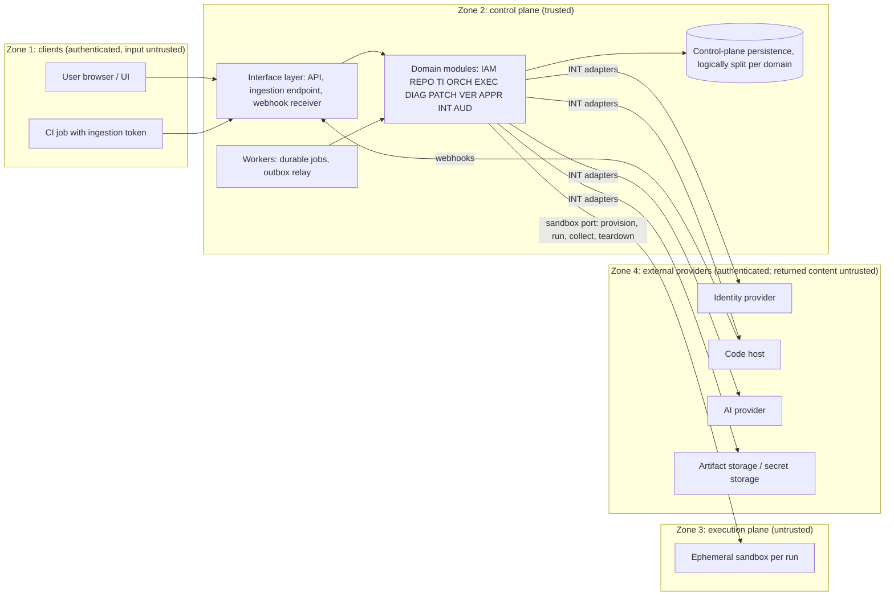
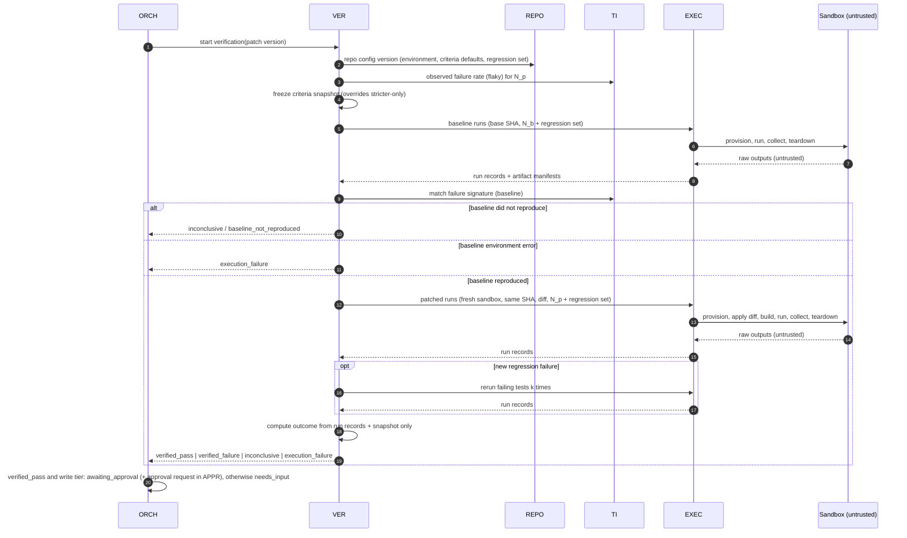

# FlakePilot — System Architecture

| | |
|---|---|
| Status | **Stage 1.2 complete**, 2026-10-20. ADR-001 to ADR-004 accepted by the project owner |
| Implements | [PRODUCT-SCOPE.md](../product/PRODUCT-SCOPE.md) (principles P1–P8, confirmed decisions D1–D4) |
| Owns | Runtime components, control plane and execution plane, trust boundaries, ports, workflow interactions, sync/async, durable execution needs, tenancy, authorization enforcement, secret handling |
| Defers to | Per-domain responsibilities and data: [DOMAIN-BOUNDARIES.md](DOMAIN-BOUNDARIES.md). Layering, import rules, dependency graph: [DEPENDENCY-RULES.md](DEPENDENCY-RULES.md). Rationale and alternatives: [ADR-001](../adr/ADR-001-modular-monolith.md), [ADR-002](../adr/ADR-002-domain-layering.md), [ADR-003](../adr/ADR-003-provider-adapters.md), [ADR-004](../adr/ADR-004-control-plane-and-execution-plane.md). Per-context language, invariants, contracts, and context interactions: [BOUNDED-CONTEXTS.md](BOUNDED-CONTEXTS.md). Service objectives, failure handling, and scaling assumptions: [RELIABILITY-AND-SLOS.md](RELIABILITY-AND-SLOS.md) |
| Not in scope | Code, data models, vendors, language/framework, job runtime, deployment. Decided in [ADR-005](../adr/ADR-005-system-of-record-database.md) to [ADR-009](../adr/ADR-009-initial-provider-adapters.md), or still deferred (see §10) |

State names, outcome taxonomies, role and grant names are used exactly as in the product scope. Domain codes come from [DOMAIN-BOUNDARIES.md](DOMAIN-BOUNDARIES.md): IAM (product and identity management), REPO (repository access), TI (test intelligence), ORCH (investigation orchestration), EXEC (browser and code execution), DIAG (AI-assisted diagnosis), PATCH (patch proposals), VER (verification), APPR (human approval), INT (external integrations), AUD (audit and observability).

---

## 1. Shape of the system

- **One deployable control plane**: a modular monolith with the 11 domains as modules ([ADR-001](../adr/ADR-001-modular-monolith.md)). It may run in more than one process role (request-serving and background workers) from the same build. These roles aren't separate services; they share the codebase and the module boundaries.
- **One untrusted execution plane**: ephemeral sandboxes from a sandbox provider behind a port. FlakePilot's own code never runs inside them ([ADR-004](../adr/ADR-004-control-plane-and-execution-plane.md)).
- **External providers**: identity, code host, CI, AI, artifact storage, secret storage. All are reached through ports owned by INT ([ADR-003](../adr/ADR-003-provider-adapters.md)).



Arrows show who starts each interaction. The sandbox never starts a connection to the control plane (§3).

---

## 2. Runtime components

| Component | Role | Notes |
|---|---|---|
| **Interface layer** | HTTP API and UI backend, ingestion endpoint (Workflow B), webhook receiver (code host or CI events), operator surface | Authenticates principals and sets the correlation ID. Calls domain application APIs. **Makes no authorization decisions** (§7.2). Never calls INT directly |
| **Domain modules** | The 11 domains. Each has domain, application, and infrastructure layers ([DEPENDENCY-RULES](DEPENDENCY-RULES.md)) | Responsibilities: [DOMAIN-BOUNDARIES](DOMAIN-BOUNDARIES.md) |
| **Workers** | Run durable jobs: stage jobs, ingestion normalization, repo validation, application, timers (approval TTL, retention), INT health probes | Same build as the interface layer. Run as `system` on behalf of the initiating principal (§7.2) |
| **Outbox relay and event dispatch** | Delivers domain events written in the same transaction as the state change. Delivery is at least once; consumers dedupe by event ID | Pattern only. In-process dispatch from the outbox decided in [ADR-006](../adr/ADR-006-durable-jobs-in-the-database.md) (§10) |
| **Control-plane persistence** | Durable state for every domain. Each domain owns its own logical store, and no domain reads another's tables | PostgreSQL, decided in [ADR-005](../adr/ADR-005-system-of-record-database.md) (§10) |
| **Sandbox provider** (external) | Creates and destroys isolated environments | Behind the sandbox port (§4) |
| **Other external providers** | Identity provider, code host, CI, AI, artifact storage, secret storage | Behind ports (§4). All are optional except identity, code host, sandbox, and storage. AI is optional (P6) |

---

## 3. Control plane vs execution plane

The execution plane is **untrusted by construction**: it runs repo and test code that FlakePilot doesn't control, and it may run AI-written patches. Product rule: PRODUCT-SCOPE §4. Rationale: [ADR-004](../adr/ADR-004-control-plane-and-execution-plane.md).

### 3.1 What crosses the boundary

| Direction | Item | Rule |
|---|---|---|
| Control → execution | **Run spec**: environment definition, commands, repeat count, timeouts, recording options, resource limits | Commands come **only** from the versioned repo config (REPO), set by holders of `repo.configure`. Never from AI output, test content, or the requester |
| Control → execution | **Source snapshot** at an exact SHA | Fetched by the control plane (REPO via the code-host port) and handed over as content. No VCS credentials and no remote configuration with tokens |
| Control → execution | **Patch diff** (verification only) | A diff that has already passed validation (PATCH, Workflow F), applied inside the sandbox |
| Control → execution | **Test-environment secrets** | Only the names listed in the repo config for that environment. Values are resolved by the sandbox adapter (INT) when provisioning. The domain layer never sees them |
| Control → execution | **Egress allowlist** | Enforced by the sandbox infrastructure *outside* the sandbox. Code inside can't change it |
| Execution → control | **Raw outputs**: test reports, exit status, logs, browser artifacts (trace, screenshots, video, console, network log, DOM snapshot), environment fingerprint | **All untrusted.** Size-capped, content-typed, hashed into a manifest, redacted by the export adapter (INT), stored through the artifact port |
| Never crosses | Code-host tokens, AI provider keys, artifact or secret storage credentials, control-plane credentials, other tenants' data, any network route to the control plane or cloud metadata endpoints | Structural: the sandbox port has no operation that carries them |

### 3.2 Boundary rules

1. **The control plane starts every interaction**: provision, execute, collect, teardown. The execution plane exposes no endpoint FlakePilot depends on, and FlakePilot exposes no endpoint to it. If a sandbox technology needs push-based artifact upload, the upload channel must be write-only, scoped to one run, size-limited, and short-lived (decision deferred with the sandbox choice).
2. **Results are claims.** The control plane re-parses raw reports and computes every outcome itself, in TI for reproduction and classification and in VER for verification. Pass/fail summaries produced inside the sandbox are never trusted.
3. **Isolation guarantees are delegated but required.** Every sandbox adapter must meet the guarantees listed for the sandbox port (§4), including teardown when the control plane crashes.
4. **Artifacts stay untrusted after export.**
   - Parsers are hardened against oversized input, entity expansion, archive bombs, and malformed encodings.
   - Artifacts are never executed in the control plane.
   - The UI serves HTML, DOM, or trace artifacts only in a way that can't run script in FlakePilot's origin (sandboxed rendering or download). The mechanism is decided in [ADR-007](../adr/ADR-007-implementation-stack-and-licensing.md) item 3 (§10).
5. **Prompt-injection containment.** Artifact and repo content can reach DIAG only as delimited data. DIAG output has three possible destinations:
   - Display, labeled with its claim status.
   - PATCH, as a candidate diff that must pass validation.
   - A sandbox, as a validated patch during verification.

   AI output can't choose commands, change config, grant permissions, set classification or verification outcomes, or trigger state transitions. The DIAG isolation invariant in [DEPENDENCY-RULES §5](DEPENDENCY-RULES.md#5-diagnosis-isolation-invariant) enforces this structurally.
6. **The control plane never runs repo code**: no repo scripts, hooks, build tools, or linters. Applying a patch in PATCH validation is a text operation. Builds happen only in sandboxes.

---

## 4. Ports (architectural interfaces)

All port contracts and adapters belong to INT ([ADR-003](../adr/ADR-003-provider-adapters.md)). Contracts are vendor-neutral, and consuming domains use them only from their application layer.

**Every adapter must:**
- Return typed errors from one shared set: `transient`, `rate_limited`, `permission_denied`, `not_found`, `conflict`, `invalid_request`, `quota_exceeded`, `unavailable`.
- Accept a correlation ID.
- Never log secret values.
- Pass the port's **conformance suite**.
- Have an in-memory **fake** for tests.

| Port | Responsibility | Operations (conceptual) | Guarantees required from every adapter | FlakePilot never relies on |
|---|---|---|---|---|
| **AI provider** (used by DIAG) | Structured inference | Describe capabilities (structured-output support, context limit, pricing metadata). Submit a request: instructions, delimited data parts, output schema, limits (tokens, time, budget). Report usage and cost | Never requests tool or side-effect execution. Returns the provider request ID. Doesn't keep or log payloads beyond the configured policy, where the provider allows that. Typed refusal and timeout errors | Determinism, calibrated confidence, schema adherence (DIAG always validates) |
| **Code host** (used by REPO) | Installation, permissions, content, branch/PR writes, events | Start and complete an installation. List reachable repos. Query installation permissions per repo. Query a linked user's permission level on a repo. Resolve a ref to a SHA. Check that a SHA is reachable. Fetch a source snapshot at a SHA. Read a file range at a SHA. **Write tier:** create a branch at a SHA (prefix enforced), commit an exact diff, open a PR, find an existing branch or PR by name. Read PR state. Verify a webhook signature and parse the event | Short-lived installation tokens kept inside the adapter. **The contract has no merge operation and no push to existing branches** (structural guarantee for P3). Rejects branch names outside the configured prefix. Lookup operations make check-then-create idempotent | That code-host content is safe. That webhooks arrive exactly once or in order |
| **CI / report source** (used by TI) | Turn CI output into normalized results | Parse a report in a supported format into normalized test results. Fetch the report referenced by a CI-completion event. Verify the event's authenticity | Deterministic parsing (same bytes give the same result). Bounded resources. Supplies the idempotency-key fields (PRODUCT-SCOPE Workflow B) or reports them as missing | Report correctness. CI timestamps for ordering security decisions |
| **Sandbox execution** (used by EXEC) | Isolated, ephemeral execution | Provision from a run spec (source snapshot, environment definition, limits, egress allowlist, secret names to inject). Execute steps. Get status. Collect artifacts (size-capped, with a hashed manifest). Cancel/teardown (idempotent). Report the environment fingerprint | All isolation properties in PRODUCT-SCOPE §4. Teardown even if the control plane disappears (self-expiry). Never reused across runs or tenants. **Separates test-level results from environment errors** (needed for the §5.4 mapping). Secret values resolved inside the adapter. Exported artifacts redacted against the injected values | Anything the sandbox reports about itself, beyond raw outputs |
| **Artifact storage** (used by TI, EXEC) | Immutable blob storage | Put (owner domain, org, repo, retention class, content type) and get a reference and hash back. Get by reference. Issue a short-lived scoped read handle. Delete (idempotent). List by owner and retention class | Objects never overwritten. Integrity hash checked on read. Tenant-namespaced keys. Encryption at rest (mechanism deferred) | Storage-level access control as the only authorization (the control plane authorizes first) |
| **Secret storage** (used through REPO, DIAG, EXEC adapters) | Write-only secret custody | Put or rotate (scope: instance, org, or repo, plus name) and get a reference back. Resolve (only inside adapters at the point of use). Delete. List names and metadata | Values never returned through any path that reaches a domain or application layer, the interface layer, events, audit, or logs. Each resolve is attributable to an org, repo, and purpose | That callers redact. Redaction is a separate best-effort step (R4) |
| **Identity provider** (used by IAM) | Authentication | Start a login. Verify the callback and get a verified external subject. Detect a revoked session. Optionally link a code-host identity | Verified subject and issuer. Authentication only | **IdP groups or claims as FlakePilot authorization.** Authorization stays in IAM (PRODUCT-SCOPE §3.1) |

**Internal infrastructure ports** (not external providers; each owned by the domain or shared kernel noted): per-domain persistence (each domain), outbox and event dispatch (shared kernel), durable job/workflow runtime (ORCH and the other job owners, §6), clock and timers (shared kernel), telemetry export (AUD). Implementations are decided in [ADR-005](../adr/ADR-005-system-of-record-database.md) (persistence), [ADR-006](../adr/ADR-006-durable-jobs-in-the-database.md) (outbox dispatch, jobs, timers), and [ADR-009](../adr/ADR-009-initial-provider-adapters.md) (telemetry export) (§10). The rest are deferred.

---

## 5. Cross-cutting runtime mechanisms

| Mechanism | Rule |
|---|---|
| **Events** | Every state change publishes a domain event in the shared-kernel envelope: event ID, org ID, repo ID, actor, action, target, before and after, reason, correlation ID, timestamp. Events go to the outbox **in the same transaction** as the change. Events never carry secret values or raw untrusted content, only references |
| **Audit** | AUD consumes **every** event envelope and appends it to the audit log. Audit records are therefore committed atomically with the action (an outbox write failure aborts the action). That satisfies PRODUCT-SCOPE's fail-closed audit rule for every audited action, not just high-risk ones. AUD doesn't interpret domain payloads |
| **Idempotency** | Every command that can be retried has a key. Ingestion: the PRODUCT-SCOPE Workflow B key plus content hash. Stage job: investigation + stage + attempt number. Run: run ID. Application: approval ID. Event consumers dedupe by event ID. External writes use the provider's idempotency key if available, otherwise **record intent → look up → create** (for example, find the branch or PR by name before creating it) |
| **Retries** | Bounded exponential backoff, used only for `transient`, `rate_limited`, and `unavailable`. After retries are exhausted, external-provider errors move the investigation to `needs_input` and control-plane errors move it to `failed` (PRODUCT-SCOPE Workflow I). `permission_denied`, `not_found`, `conflict`, and `invalid_request` are never retried. `quota_exceeded` is handled as in PRODUCT-SCOPE Workflow J (rejection, or `needs_input` / `quota_exceeded`) |
| **Leases** | A stage job holds a renewable lease. When a lease expires, the job re-runs idempotently up to a bounded count. After that the investigation moves to `failed` |
| **Cancellation** | ORCH records the intent to cancel. Running jobs check for cancellation at step boundaries and receive a signal. EXEC tears down sandboxes through the port (idempotent). Partial artifacts are kept and labeled partial. `applying` refuses cancellation (PRODUCT-SCOPE Workflow H) |
| **Correlation** | The interface layer creates a correlation ID per request. It's carried through jobs, events, port calls, sandbox labels (non-secret), and AI request metadata |
| **Consistency** | One domain per transaction. Cross-domain effects happen through events (eventual consistency) or synchronous query APIs. No distributed transactions |

---

## 6. Sync vs async, and durable execution

| Operation | Mode | Why |
|---|---|---|
| Authentication, authorization decisions, reads and queries | Sync | Bounded, local |
| Config edits, grants, membership, secret writes, ingestion-token issuance | Sync | User waits. Single domain |
| Ingestion acceptance (auth, limits, schema, idempotency, raw store) | Sync (returns the upload ID) | Fast feedback to CI |
| Ingestion normalization, SHA-existence check | Async | Unbounded size, external call |
| Repo onboarding validation, optional dry run | Async | External calls, sandbox |
| Investigation creation | Sync (returns `queued`) | — |
| Every stage: evidence/classification, reproduction, diagnosis, patch generation and validation, verification | Async, durable | Minutes to hours (verification can need dozens of runs) |
| Approve or reject decision | Sync | Recording a decision is local and immediate |
| Application (branch and PR) | Async, durable | Multi-step external side effects with idempotent resume |
| Cancel request | Sync acceptance, async teardown | — |
| Staleness reactions, approval TTL, retention deletion, archival, health probes, audit append | Async | Event- or timer-driven |

**Durable workflow execution: required eventually, runtime decided in [ADR-006](../adr/ADR-006-durable-jobs-in-the-database.md).** These flows need persistent step state, timers, cancellation signals, and resume after a crash:

1. **The investigation lifecycle.** It spans days, including human waits in `needs_input` and `awaiting_approval`, and must resume from the last completed stage.
2. **Verification internals.** Baseline, then patched, then regression, then reruns of new failures.
3. **Application.** Recheck, branch, commit, PR, consume, with partial-progress resume.
4. **Timers.** Approval TTL, retention, lease expiry.
5. **Outbox relay.**

Requirements for whatever is chosen:
- Step state durable before acknowledgment.
- At-least-once step execution, with every step idempotent (§5).
- Durable timers.
- Cancellation delivered to running steps.
- Operator visibility into stuck work (PRODUCT-SCOPE Workflow J).
- No correctness that depends on in-memory state.

A database-backed job table with leases or a dedicated workflow engine could both satisfy this. **The choice, a database-backed job table, is decided in [ADR-006](../adr/ADR-006-durable-jobs-in-the-database.md)** (§10).

---

## 7. Tenancy, authorization, data ownership, secrets

### 7.1 Multi-tenant isolation

| Layer | Isolation rule |
|---|---|
| Data | Every tenant-owned record carries an org ID, plus a repo ID where it applies. A data-access guard rejects any query without tenant scope (defense in depth beneath authorization). Unguessable IDs are **not** treated as a control |
| Events and audit | The envelope carries the org ID. Consumers keep it. Audit queries are tenant-filtered |
| Artifacts | Tenant-namespaced keys. Reads only through the control plane after authorization, or through short-lived scoped handles |
| Secrets | Scoped per instance, org, or repo. A resolve is attributable to an org, repo, and purpose |
| Execution | One sandbox per run. Never shared or reused across runs or tenants |
| AI | Per-org provider config and credentials, or instance defaults allowed by the operator. Requests carry only that org's data. Caches keyed by tenant |
| Capacity | Per-org quotas (IAM) limit noisy neighbors |
| Operators | Metadata only. Content needs break-glass (IAM grant: time-limited, audited, org admins notified) |

Physical isolation (a store or deployment per tenant) is deferred. The logical model above doesn't depend on it.

### 7.2 Authorization enforcement

| Point | What it does |
|---|---|
| **Interface layer** | **Authentication only.** It establishes the principal: user session, ingestion token, or `system`. No business authorization decisions |
| **Application layer: the enforcement point** | Every command and query handler in every domain calls the **IAM decision point** before doing work. The decision combines FlakePilot grants with code-host permission (PRODUCT-SCOPE §3.1 intersection rule). IAM gets code-host permission through the `CodeHostAccessVerifier` port, which IAM defines and REPO implements ([DEPENDENCY-RULES §4](DEPENDENCY-RULES.md#4-inverted-ports-cycle-breaking)). The code-host check is live for approve and apply, and may be cached for reads (Q6) |
| **Async jobs** | Authorized when enqueued. They run as `system` with the initiating principal recorded. High-risk steps **re-authorize when they run**: application rechecks the approver's `repo.approve` and code-host write (PRODUCT-SCOPE Workflow H) |
| **Data-access guard** | Tenant scope (§7.1) |
| **Code host** | Enforces its own permissions on the least-privilege installation token |

Separation of duties (D2) is checked in APPR: the investigation creator comes from the approval request ORCH creates, the patch human author from PATCH, and the org member count from IAM.

### 7.3 Data ownership

Each domain exclusively owns its records ([DOMAIN-BOUNDARIES](DOMAIN-BOUNDARIES.md), "Data owned" for each domain). Other domains refer to them by ID and read them only through the owner's query API.

### 7.4 Secret-handling boundaries

| Where secret values may exist | Where they may never exist |
|---|---|
| The secret store. INT adapters at the moment of use (provider auth, code-host app auth, sandbox injection, export redaction). The sandbox environment (only listed test-environment secrets) | Domain and application layers, the interface layer, events, audit records (names only), logs, AI payloads, PR bodies, stored artifacts (best-effort redaction, R4) |

Secret entry is write-only. It goes through the owning domain's use case: REPO for test-environment secrets (`repo.configure`), DIAG for AI provider credentials (org admin), deployment configuration for instance-level credentials (deferred). That domain authorizes through IAM, calls the secret port, and stores only the returned reference.

---

## 8. Workflow interactions (A–J)

Product behavior, states, and failure semantics are defined in PRODUCT-SCOPE §6 and aren't repeated here. This section shows **which component does what**, plus the mechanics: sync/async, idempotency, retries, cancellation, and audit events. Event names follow `entity.event`, and AUD records every event (§5).

### A — Repository onboarding

| Step | Interaction | Mode |
|---|---|---|
| 1 | Interface → REPO "start connection" (IAM: org admin) → code-host port starts the installation (state parameter bound to the session) | Sync |
| 2 | Code host callback → Interface → REPO "complete installation" (verify state) → list repos | Sync |
| 3 | Admin selects repos → REPO creates connections in `pending_validation` and stores the config version (secret names resolved to references through the secret port) | Sync |
| 4 | Worker: REPO validation job (permission probes through the code-host port, config parse, secret references exist) → `active` or `validation_failed` | Async |
| 5 | Interface → IAM "grant" (IAM: org admin or `repo.configure`; `approve` only by org admin, D2) → `CodeHostAccessVerifier` (REPO) checks the grantee's code-host access. IAM "issue ingestion token" (only a hash stored, shown once) | Sync |
| 6 | Optional: Interface → EXEC "dry run" (sandbox run of the configured command; result recorded, never blocks activation) | Async |
| Later | Code-host webhook (installation changed or revoked, repo archived) → REPO → `degraded` / `disconnected`. Code-host permission errors anywhere → REPO re-validates → `degraded` | Async |

- **Idempotency.** The validation job is keyed by connection + config version. Installation completion is keyed by installation ID.
- **Retries.** Validation probes on transient errors. A permanent missing permission → `validation_failed` with the permission named.
- **Cancellation.** An abandoned installation flow leaves nothing behind.
- **Audit events.** `repo_connection.state_changed`, `repo_config.version_created`, `grant.issued` / `grant.revoked`, `ingestion_token.issued` / `ingestion_token.revoked`, `dry_run.finished`.

### B — Test-result ingestion

| Step | Interaction | Mode |
|---|---|---|
| 1 | CI → Interface (ingestion endpoint) → IAM authenticates the ingestion token (scope: one repo) → TI "accept upload": size/rate limits (IAM quota), schema, idempotency check, raw report stored through the artifact port, upload `received` | Sync, returns the upload ID |
| 1′ | Alternative: code-host or CI webhook → Interface → CI port verifies authenticity → TI fetches the report through the CI port → same acceptance path | Async |
| 2 | Worker: TI normalization (CI port parser) → test results and history → `processed` or `processing_failed` | Async |
| 3 | Worker: TI → REPO "check SHA reachable" → flag `unverified_revision` if not | Async |

- **Idempotency.** Same key + same hash → returns the existing upload. Same key + different hash → conflict, rejected.
- **Retries.** Normalization and SHA check on transient errors. The client can safely resubmit.
- **Failure.** Rejections are synchronous, machine-readable, and audited.
- **Cancellation.** Not applicable.
- **Audit events.** `upload.received`, `upload.duplicate`, `upload.rejected`, `upload.processed`, `upload.processing_failed`, `quota.denied`.

### C — Investigation, evidence, and classification

| Step | Interaction | Mode |
|---|---|---|
| 1 | User → Interface → ORCH "create investigation" (IAM: `repo.investigate`; IAM quota for active investigations; REPO repo `active`; ORCH dedup check Q8) → `queued`. **Only user-initiated (D3)**: no event consumer creates investigations | Sync |
| 2 | Worker: ORCH → `running` / stage `evidence` → TI "assemble evidence and classify" (history query, evidence bundle version sealed, versioned rules applied) | Async, durable |
| 3 | ORCH reads auto-advance from the REPO config → starts the next stage, or → `needs_input` | Async |

- **Idempotency.** The stage job is keyed by investigation + stage + attempt. Evidence-bundle versions are immutable, and classification is deterministic over the same evidence.
- **Retries.** The lease/retry rule in §5. Internal failure after retries → `failed`.
- **Cancellation.** ORCH cancel → the job stops at its next step boundary → `cancelled`.
- **Audit events.** `investigation.state_changed`, `evidence.sealed`, `classification.recorded`.

### D — Browser reproduction

| Step | Interaction | Mode |
|---|---|---|
| 1 | User or auto-advance → ORCH → `running` / stage `reproduction` → EXEC "start run" with a run spec built from the REPO config (IAM: sandbox quota reserved) | Async, durable |
| 2 | EXEC → REPO fetches the source snapshot at the SHA → sandbox port provisions (secret names from config, egress allowlist, limits) → runs N times → collects artifacts (redacted, manifest) → teardown | Async |
| 3 | ORCH → TI "evaluate reproduction" (TI re-parses the raw outputs, matches signatures) → reproduction outcome → TI re-runs classification → new classification version | Async |
| 4 | ORCH → `needs_input` (or the next stage) | Async |

- **Idempotency.** Keyed by run ID. A rerun after lease expiry tears down any orphaned sandbox first.
- **Failure.** A sandbox `unavailable` error or environment error → outcome `execution_failure`. Missing secrets → `unsupported` / `missing_secrets`, decided before provisioning.
- **Retries.** Provisioning on transient errors.
- **Cancellation.** EXEC tears down. Artifacts are kept and marked partial.
- **Audit events.** `run.requested`, `run.started`, `run.finished` (with outcome), `run.cancelled`, `artifacts.exported` (manifest hash, injected secret names), `reproduction.evaluated`, `classification.recorded`.

### E — AI-assisted diagnosis

| Step | Interaction | Mode |
|---|---|---|
| 1 | ORCH → `running` / stage `diagnosis` → DIAG "diagnose" (evidence version) | Async, durable |
| 2 | DIAG checks: org data policy (DIAG-owned), provider configured and healthy (INT), AI-spend quota (IAM). If any fails → outcome `unavailable` (or `quota_exceeded`) → ORCH `needs_input` | Async |
| 3 | DIAG builds the request: evidence through the TI query API; artifact excerpts through EXEC; source excerpts through REPO only if the policy is `evidence_and_source`. Untrusted content is delimited. Request metadata recorded **before** sending | Async |
| 4 | AI port → response → schema validation (bounded retries, then `rejected`) → mechanical claim checks against TI/EXEC/REPO → `evidence_linked` / `unverified` / `contradicted` → diagnosis stored | Async |

- **Isolation invariant.** DIAG has **no command path** into TI, VER, or APPR, and none of them can read DIAG ([DEPENDENCY-RULES §5](DEPENDENCY-RULES.md#5-diagnosis-isolation-invariant)).
- **Idempotency.** Keyed by investigation + evidence version + attempt. A rerun is a new diagnosis record. Spend is counted per actual provider call.
- **Retries.** Provider transient and rate-limited errors (bounded). After that the job is `errored` → `needs_input`.
- **Cancellation.** In-flight provider calls are abandoned, cost is recorded, and nothing is stored as a hypothesis.
- **Audit events.** `ai_request.sent` (provider, model, policy level, payload hash and size), `diagnosis.recorded` (outcome, claim-status counts, cost), `override.recorded`.

### F — Patch proposal

| Step | Interaction | Mode |
|---|---|---|
| 1a | AI patch: user picks a hypothesis → ORCH first gets PATCH's classification-precondition decision (PRODUCT-SCOPE Workflow F preconditions; if not met, the request is refused) → ORCH → `running` / stage `patch` → DIAG "generate patch candidate" (same policy and validation path as E; an override is needed when no claim is `evidence_linked`) → candidate diff | Async, durable |
| 1b | Human patch: user → Interface → ORCH "submit human patch" (IAM: `repo.investigate`) | Sync acceptance |
| 2 | ORCH → PATCH "submit candidate" (diff, provenance `ai` or `human`, base SHA, opaque hypothesis reference) → `validating` | Async |
| 3 | PATCH validation: classification precondition (TI, including an audited `inconclusive` override), apply to the base SHA as a text operation (REPO snapshot), scope rules (REPO config version), size, content and secret scan, masking → `valid` or `invalid`. Earlier valid version → `superseded` | Async |

- **Idempotency.** Patch version identity = diff hash + base SHA + provenance. Resubmitting an identical candidate returns the existing version.
- **Failure.** Base SHA unreachable → `needs_input` (new target revision needed). Generation failures follow the E rules.
- **Cancellation.** Stops generation or validation. No version is created mid-validation.
- **Audit events.** `patch_version.created`, `patch.validated` (`valid`/`invalid` + reasons), `patch.superseded`, `override.recorded`.

### G — Verification



- **Outcome computation** is a pure domain function in VER over run records and the frozen criteria snapshot. It has no DIAG input.
- **Idempotency.** Keyed by verification ID. Each phase is a durable step. On resume, completed phases aren't rerun, and an incomplete phase restarts with a fresh sandbox (its partial runs are discarded and labeled).
- **Retries.** Environment errors may be retried within the phase (bounded). If they persist → `execution_failure`.
- **Supersession.** A new verification of the same patch supersedes the earlier one and publishes `verification.superseded`, which APPR consumes for staleness.
- **Cancellation.** EXEC tears down all sandboxes. The verification is left without an outcome (`cancelled`).
- **Audit events.** `verification.started` (criteria snapshot hash), `run.*`, `verification.completed` (outcome, reason code), `verification.superseded`, `verification.cancelled`.

### H — Human approval and application

```mermaid
sequenceDiagram
    autonumber
    actor A as Approver
    participant IF as Interface
    participant AP as APPR
    participant I as IAM
    participant R as REPO
    participant O as ORCH
    participant P as PATCH
    Note over O,AP: On verified_pass ORCH opened an approval request in APPR (investigation creator, patch version, verification)
    A->>IF: approve(patch version, comment)
    IF->>AP: record decision
    AP->>I: authorize repo.approve (IAM checks code-host write live via REPO verifier)
    AP->>AP: eligibility: patch valid and not superseded, latest verification verified_pass, write tier, repo active, D2 separation of duties, masking acknowledged
    AP-->>IF: decision recorded (approval active)
    AP--)O: event decision.recorded(approve)
    O->>O: awaiting_approval to applying
    O->>AP: apply(approval ID) [durable job]
    AP->>I: re-authorize approver (repo.approve + code-host write)
    AP->>AP: recheck every staleness trigger (base SHA reachable via REPO)
    alt stale
        AP->>AP: approval invalidated
        AP-->>O: application failed (stale)
        O->>O: applying to needs_input
    else valid
        AP->>R: find-or-create branch at base SHA under prefix, commit exact diff (hash checked), find-or-open PR
        R-->>AP: PR reference, or typed error
        alt success
            AP->>AP: approval consumed
            AP-->>O: application succeeded
            O->>P: mark patch applied
            O->>O: applying to completed (patch_applied)
        else failure after bounded retries
            AP-->>O: application failed (reason); approval stays active unless a trigger fired
            O->>O: applying to needs_input
        end
    end
```

- **Staleness.** APPR consumes `patch_version.created`, `verification.superseded`, `repo_config.version_created` (scope or criteria changes), `grant.revoked`, and `repo_connection.state_changed`, plus its own TTL timer. ORCH calls APPR "invalidate for investigation" when an investigation is cancelled.
  - With an active approval: → `invalidated`.
  - Without an approval, while `awaiting_approval`: the approval request loses eligibility → `approval.eligibility_lost` → ORCH moves to `needs_input`.
  - **Target-branch drift isn't a trigger (D1).**
- **Rejection.** A synchronous decision record (IAM: `repo.approve` only) → event → ORCH moves to `needs_input`.
- **Retrying application from `needs_input`.** ORCH checks that an `active` approval exists (IAM: `repo.approve` + code-host write) → `applying`.
- **Idempotency.** Application is keyed by approval ID. Branch and PR use find-or-create through the code-host port. After a crash between PR creation and `consumed`, the retry finds the PR and then consumes.
- **Structural guarantees.** The code-host port has no merge or push-to-existing-branch operation (§4). Cancellation is refused during `applying`.
- **Audit events.** `approval_request.opened`, `decision.recorded`, `approval.invalidated` (trigger), `approval.eligibility_lost`, `application.attempted`, `application.succeeded` (branch, PR), `application.failed`, `approval.consumed`, `patch.applied`.

### I — Investigation lifecycle

ORCH is the only writer of investigation state. Each transition in the PRODUCT-SCOPE Workflow I diagram is caused by one of these:

| Transition | Caused by |
|---|---|
| `queued → running` | Worker picks up the job (capacity available) |
| `running → needs_input` | A stage job finishes with any outcome, an external-provider error persists after retries, or quota is exceeded (`quota_exceeded`) |
| `running → awaiting_approval` | `verification.completed` = `verified_pass` and the repo has the write tier. ORCH opens an approval request in APPR |
| `running → failed` | Control-plane error after the lease/retry limit |
| `needs_input → running` | User command (IAM: `repo.investigate`) |
| `needs_input → applying` | User retries application. An `active` approval exists (IAM: `repo.approve` + code-host write) |
| `needs_input → completed` | User closes with a reason (IAM: `repo.investigate`) |
| `awaiting_approval → applying` | `decision.recorded` (approve) |
| `awaiting_approval → needs_input` | `decision.recorded` (reject) or `approval.eligibility_lost` |
| `applying → completed` | `application.succeeded`. ORCH marks the patch `applied` through PATCH |
| `applying → needs_input` | `application.failed` |
| `failed → running` | User retry. Resumes after the last completed stage |
| `queued`, `running`, `needs_input`, `awaiting_approval` → `cancelled` | User cancel. Teardown is propagated. APPR invalidates any active approval |
| `completed`, `failed`, `cancelled` → `archived` | User archive, or `system` according to the retention policy (IAM) |

- **Idempotency.** Transitions are conditional on the current state (compare-and-set). Duplicate events are no-ops.
- **Retries and failure.** Stage jobs use the lease/retry rule (§5). Exhausted control-plane retries → `failed`. Exhausted external-provider retries → `needs_input`. A user retry from `failed` resumes after the last completed stage.
- **Cancellation.** Accepted in `queued`, `running`, `needs_input`, and `awaiting_approval`. Refused in `applying`. Teardown and approval invalidation are propagated asynchronously and idempotently.
- **Audit events.** `investigation.state_changed` (from, to, stage, actor, reason).

### J — Administration and operations

| Area | Owner and interactions | Mode | Audit events |
|---|---|---|---|
| Access management | IAM (members, grants, last-admin guard, break-glass). `grant.revoked` → APPR invalidates affected approvals | Sync, plus async reactions | `member.*`, `grant.*`, `break_glass.started` / `break_glass.ended` |
| Audit history | AUD query and export (IAM: org admin for the org; `repo.view` for the repo trail). Append-only. Nobody can edit, operators included | Sync query, async export | `audit.exported` |
| Integration config | Entered through the consuming domain: REPO (code host), DIAG (AI provider, credentials, data policy), EXEC (sandbox, operator), IAM (identity provider, operator). INT stores credential references and runs health probes | Sync, plus periodic probes | `integration.config_changed`, `integration.health_changed` |
| Quotas | IAM decides. Checked by TI (ingestion), ORCH (creation), EXEC (sandbox), and DIAG (AI spend, also during a request) | Sync check | `quota.changed`, `quota.denied` |
| Artifact retention | IAM owns the policy. Each data owner (TI raw reports, EXEC run artifacts) runs idempotent deletion jobs. TI, the evidence owner, marks the affected items removed in evidence (mechanism open: [BOUNDED-CONTEXTS BC-Q5](BOUNDED-CONTEXTS.md#6-open-questions)). ORCH archives | Async, timers | `retention_policy.changed`, `artifact.deleted` (EXEC run artifacts, batch), TI raw-report deletion event (not yet named: BC-Q4), `investigation.state_changed` |
| Troubleshooting | ORCH (stuck leases, queues), TI (failed ingestion), INT (health), AUD (correlation and metrics). Operators see metadata only | Sync query | Break-glass sessions |

- **Failure.**
  - A grant to someone without matching code-host access is rejected (IAM through `CodeHostAccessVerifier`). Removing the last org admin is rejected.
  - Quota violations are explicit rejections, or `needs_input` / `quota_exceeded` for a running stage. Quotas never degrade silently.
  - An unhealthy integration makes dependent stages report `unavailable`. Core functions keep working (P6).
  - A failed audit export can be retried and leaves no partial export visible.
- **Idempotency.**
  - Grant and revoke are idempotent on (principal, repo, grant). Revoking twice is a no-op.
  - Retention deletion is keyed by (owner domain, artifact reference), and the artifact port's delete is idempotent.
  - Archival is a compare-and-set transition.
  - Break-glass sessions have IDs, so ending one twice is a no-op.
- **Retries.** Retention deletion, health probes, and audit export retry with bounded backoff on `transient`, `rate_limited`, or `unavailable`. Retention deletion that keeps failing alerts the operator (PRODUCT-SCOPE Workflow J).
- **Cancellation.** A break-glass session can be ended early by the operator or an org admin. Retention and export jobs can be stopped by the operator and resumed idempotently. Config and grant changes are synchronous, so there's nothing to cancel.

---

## 9. Requirement traceability

| Requirement | Where it is met |
|---|---|
| Modular monolith, no microservices | §1, [ADR-001](../adr/ADR-001-modular-monolith.md) |
| Domain responsibilities and dependencies, acyclic | [DOMAIN-BOUNDARIES](DOMAIN-BOUNDARIES.md), [DEPENDENCY-RULES §3](DEPENDENCY-RULES.md#3-domain-dependency-graph) |
| AI can't influence classification or verification | §3.2 rule 5, [DEPENDENCY-RULES §5](DEPENDENCY-RULES.md#5-diagnosis-isolation-invariant) |
| Layer direction, vendor-free domain | [DEPENDENCY-RULES §1–2](DEPENDENCY-RULES.md), [ADR-002](../adr/ADR-002-domain-layering.md) |
| Control plane vs execution plane | §3, [ADR-004](../adr/ADR-004-control-plane-and-execution-plane.md) |
| Workflows A–J | §8 |
| Ports | §4, [ADR-003](../adr/ADR-003-provider-adapters.md) |
| Sync/async, durable execution | §6 |
| Tenancy, authorization enforcement, data ownership, secrets | §7 |

---

## 10. Unresolved and deferred decisions

| Decision | Status | Constraint set by this architecture |
|---|---|---|
| Implementation language and framework | Python and FastAPI: [ADR-007](../adr/ADR-007-implementation-stack-and-licensing.md) | Must support automated module-boundary checks ([DEPENDENCY-RULES §7](DEPENDENCY-RULES.md#7-enforcement)) |
| Durable workflow / job runtime | Database-backed jobs: [ADR-006](../adr/ADR-006-durable-jobs-in-the-database.md) | §6 requirements |
| Event dispatch mechanism (in-process vs broker) | In-process from the outbox: [ADR-006](../adr/ADR-006-durable-jobs-in-the-database.md) | Transactional outbox, at-least-once delivery, dedupe by event ID (§5) |
| Persistence technology, physical tenant isolation | PostgreSQL: [ADR-005](../adr/ADR-005-system-of-record-database.md) (Accepted). Physical isolation deferred | Logical per-domain ownership, tenant guard (§7) |
| Sandbox technology and artifact transfer (pull vs scoped push) | Hardened containers: [ADR-008](../adr/ADR-008-deployment-and-trust-model.md). Transfer mode deferred | §3, sandbox-port guarantees (§4) |
| Code host, CI sources, report format, browser framework | [ADR-009](../adr/ADR-009-initial-provider-adapters.md) | Port guarantees (§4) |
| AI provider(s) | None at launch: [ADR-009](../adr/ADR-009-initial-provider-adapters.md) | AI port guarantees. Optional (P6) |
| Identity provider | [ADR-009](../adr/ADR-009-initial-provider-adapters.md) | Authentication only. No IdP-claim authorization |
| Artifact and secret storage | [ADR-009](../adr/ADR-009-initial-provider-adapters.md) | Port guarantees (§4) |
| Safe rendering of untrusted HTML/DOM artifacts | Separate origin: [ADR-007](../adr/ADR-007-implementation-stack-and-licensing.md) | Must not run in the FlakePilot origin (§3.2) |
| Code-host permission cache TTL | Deferred (Q6) | Live for approve and apply |
| Audit tamper evidence | Deferred | Append-only now |
| Deployment topology, process roles, scaling | [ADR-008](../adr/ADR-008-deployment-and-trust-model.md). Scaling deferred | One build. Roles aren't services (§1) |

Stage 1.4 decision inventory and owner answers: [ADR index](../adr/README.md).

---

## 11. Product-scope alignment

Resolved 2026-10-20: PRODUCT-SCOPE §8 and Workflow C updated to match [ADR-003](../adr/ADR-003-provider-adapters.md) and [DOMAIN-BOUNDARIES](DOMAIN-BOUNDARIES.md).
