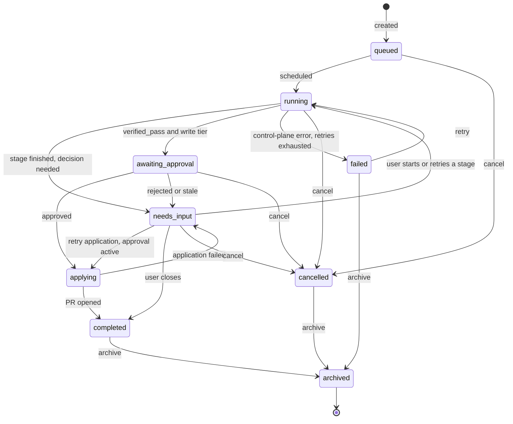

# FlakePilot — Product Scope

| | |
|---|---|
| Status | **Stage 1.1 scope.** Core product decisions D1–D4 confirmed by the owner on 2026-10-20 (§11). The remaining open questions are deferred to later stages |
| Scope | Product behavior only. No technology, data model, provider, or deployment choices (see §12). |
| Repository state when written | The directory was empty and was not a git repository: no code, docs, ADRs, or history. Nothing existing had to be kept or reconciled. **Nothing below exists yet.** Everything here is planned scope. |

---

## 1. Mission and target users

**Mission.** Help software teams decide, based on evidence, why a recurring test failure happens and whether a proposed fix actually works. FlakePilot classifies failures, reproduces them in isolation (with browser evidence where it applies), drafts minimal patches with AI help, and checks each patch through repeated executions against acceptance criteria that are written down before the run. A human approves before anything reaches the user's repository.

**Non-negotiable principles** (the rest of this document follows from these):

| # | Principle | Consequence in this scope |
|---|---|---|
| P1 | AI output is a proposal, never a fact | AI never sets a classification, a verification outcome, or a state transition (§5, Workflows E and F) |
| P2 | Verification means actual execution against explicit criteria | Four verification outcomes. A single passing run proves nothing (Workflow G) |
| P3 | A human approves before any change reaches a user repository | Approval is tied to an exact patch, revision, and verification. Applying means opening a branch and PR, never merging (Workflow H) |
| P4 | Infrastructure and AI providers are replaceable | Code host, CI, sandbox, AI, storage, and identity sit behind interfaces (§8) |
| P5 | Modular monolith with strict domain boundaries | §8 lists the domains. Splitting into services is a non-goal until needed (§9) |
| P6 | Core features don't depend on any one AI model or sponsor | Ingestion, classification, reproduction, and verification all work with AI disabled |
| P7 | Distinguish flaky, deterministic regression, infrastructure, and inconclusive | Classification taxonomy (§5.1) |
| P8 | Important decisions and transitions are auditable | Every workflow lists its audit events. The audit log is append-only (§7) |

**Target users.**

| User | Need |
|---|---|
| Application or test engineer on a team with a recurring CI failure | "Is this flaky, a real regression, or infrastructure? What's the smallest fix, and does it hold up?" |
| Tech lead or maintainer | Review evidence and patches before anything touches the repo. Track the flake backlog |
| Platform or developer-productivity team | Run FlakePilot for many repos and teams, with quotas, isolation, and audit |
| Solo or open-source maintainer | The same workflows without org overhead (an "org of one") |

---

## 2. Glossary

| Term | Meaning |
|---|---|
| **Test identity** | Stable key for a test inside a repo: suite/file path + test name + parameters. Renames are an open question (Q5) |
| **Test result** | One outcome of one test identity in one run: `passed`, `failed`, `errored`, or `skipped`, plus duration, message, and stack |
| **Run** | One execution of a test set at one commit SHA in one declared environment. It comes from CI (ingested) or from FlakePilot (reproduction or verification) |
| **Failure signature** | Normalized error type, message pattern, and failing location/step, used to decide whether two failures are "the same" |
| **Evidence bundle** | Immutable, referenceable collection of history, results, logs, and artifacts for one investigation. Each item has an evidence ID |
| **Base SHA** | The exact commit a patch is written against and verified at |
| **Acceptance criteria** | Thresholds recorded before verification starts (repeat counts, regression set, pass rules). They are part of the verification record |
| **Code host** | External source-control platform (provider not yet chosen, see §12) |

---

## 3. Roles and permission boundaries

### 3.1 Four checks that must stay separate

| Concept | Question it answers | Source of truth | Never substitutes for |
|---|---|---|---|
| **Authentication** | Who is this principal? | External identity provider (§12), or a scoped token for services | Any permission |
| **Authorization** | What may this principal do *in FlakePilot*? | FlakePilot org roles and repo grants (§3.3) | Code-host permissions or approval |
| **Repository permission** | What may this user, and FlakePilot's app installation, do *on the code host*? | Code host, checked live or with a short-lived cache (Q6) | FlakePilot authorization or approval |
| **Patch approval** | Has an authorized human accepted *this exact patch at this exact base SHA with this exact verification*? | Immutable approval record (Workflow H) | Authorization in general. It authorizes one application, nothing more |

**Rule: effective access is the intersection of all checks.** FlakePilot never gives a user more reach into a repository than the code host does:

- Any repo-scoped read in FlakePilot requires code-host read access for that user.
- Approving requires code-host write access.
- Application can only happen through the installation's write tier.

### 3.2 Role model decision

Six candidate roles were considered. Two are real roles, one is the solo case of another, and three are better modeled as per-repo grants.

| Candidate | Decision | Why |
|---|---|---|
| Platform operator | **Role** (instance level) | Different trust domain from tenants. Runs the deployment and should not see tenant data by default |
| Organization admin | **Role** (org level) | Owns membership, integrations, quotas, and policy |
| Individual developer | **Not a role** | An org of one, holding org admin plus all grants |
| Repository owner/admin | **Grant** `repo.configure` | Same person type as a member, with more capabilities on specific repos |
| Investigator/developer | **Grant** `repo.investigate` | A capability on specific repos |
| Reviewer/approver | **Grant** `repo.approve` | A capability on specific repos. It is kept separate so approval power is always granted on purpose |

Non-human principal: an **ingestion token** is scoped to one repo and can only ingest. It is not a user.

### 3.3 Capabilities

| Grant (per repo) | Implies | Allowed actions |
|---|---|---|
| `repo.view` | — | Read test history, investigations, evidence, artifacts, diagnoses, patches, verification results, and the repo's audit trail |
| `repo.investigate` | `view` | Create, cancel, and retry investigations. Request reproduction, diagnosis, patch proposal, and verification. Submit a human-revised patch. Export unapproved patches. Archive |
| `repo.approve` | `view` | Approve or reject patches that are verified and not stale (Workflow H) |
| `repo.configure` | `investigate` | Edit repo config (commands, environments, acceptance criteria, patch scope, auto-advance, test-environment secrets), issue and revoke ingestion tokens, manage grants on this repo except `approve` (only org admins grant `approve`, D2) |

Org members have no repo access until granted. Org admins implicitly hold `configure` on every org repo but **not** `approve`. Approval power must always be granted explicitly, even to yourself.

### 3.4 Selected roles

| | Platform operator | Org admin | Org member (with grants) | Ingestion token |
|---|---|---|---|---|
| **Responsibilities** | Deployment health, instance-level integrations and defaults, global quotas, incident response | Membership, repo connections, org integrations (code host, AI provider, data policy), quotas within the instance limit, retention, audit review | Investigation, approval, and configuration work on granted repos | Submitting test reports |
| **Allowed** | Read operational metadata (job states, error codes, usage). Set instance limits. Suspend an org. Break-glass access to tenant data (see forbidden) | Everything in §3.3 on every org repo except `approve` unless granted. Manage members and grants. Configure the AI provider and data-sharing policy. Read and export the org audit log | Actions from their grants on granted repos only | Workflow B for its single repo |
| **Forbidden** | Reading tenant code, artifacts, or prompts without break-glass (time-limited, reason required, audited, visible to org admins). Approving patches. Changing tenant grants | Approving without an `approve` grant. Reading secret values (secrets are write-only). Editing or deleting audit records. Bypassing code-host permissions | Anything on repos without a grant. Approving without code-host write. Reading secret values | Every other action |
| **Repo / org scope** | Whole instance, operational plane only | One org, all its repos | Specific repos in one org | One repo |
| **Approval authority** | None | Only with an explicit `approve` grant | Only with an `approve` grant **and** code-host write | None |
| **Logs, artifacts, history** | Metadata only. Content only through break-glass | All in the org | Granted repos only | None (can't read back) |

---

## 4. Cross-cutting security boundaries

These apply to every workflow. Each workflow refers back here instead of repeating them.

| Boundary | Rule |
|---|---|
| **Sandbox isolation** | All repo and test code is untrusted. It runs only in ephemeral, per-run, isolated environments with: no shared state across runs or tenants; no network path to FlakePilot's control plane or cloud metadata endpoints; egress denied by default except a per-repo allowlist; CPU, memory, disk, and time limits; destruction after the run. Artifacts leave only through a size-limited export channel |
| **Secrets** | Secrets are write-only after entry, scoped to an org or repo, and injected into a sandbox only when the repo config lists them for that environment. They are never sent to AI providers or written into PR bodies, never shown in the UI, and redacted from logs and artifacts on a best-effort basis (risk R4) |
| **Least-privilege code-host access** | Short-lived installation tokens, held by the control plane and never handed to sandboxes. Sandboxes get source code, not credentials. **Read tier**: contents, metadata, CI status. **Write tier** (optional, opt-in per repo): create branches under a fixed prefix and open PRs. Never requested: admin, merge, branch-protection changes, CI-workflow-file writes (R6) |
| **Untrusted content / prompt injection** | Repo files, test names, logs, report payloads, DOM content, and PR/issue text are *data*. They can't change configuration, permissions, or state transitions. AI output is also untrusted: it goes through schema validation and patch validation, and only reaches execution as a patch inside the sandbox |
| **Data sent to AI providers** | Org policy, defaulting to **AI disabled**. Levels: `disabled` → `evidence_only` (redacted logs, stacks, test metadata) → `evidence_and_source` (adds source excerpts). Every request is recorded with provider/model, policy level, payload hash, and size |
| **No privilege escalation through FlakePilot** | See §3.1 |

---

## 5. Outcome taxonomies

These are kept separate on purpose. **Job state** (did the machinery run?) is not **outcome** (what did the run show?), and neither is **AI confidence** (what did the model claim?).

### 5.1 Failure classification (Workflow C)

Classification is computed by **explicit, versioned rules over execution evidence**. AI never sets or overrides it (P1). Every classification records the rule version, the evidence IDs used, and the time. A classification can be revised as evidence arrives, for example after reproduction. Every version is kept.

| Class | Evidence required (thresholds provisional, §10) |
|---|---|
| `flaky` | The same test identity both passed and failed at the **same commit SHA** in the same declared environment (in history, retries within one CI run, or reproduction), with no infrastructure signal on the failing runs |
| `deterministic_regression` | It fails with a consistent failure signature in every observed run at revision R (minimum count provisional), **and** passed at an earlier known revision. Consistent failure with no known passing baseline gives `inconclusive` with reason `no_passing_baseline` (D4) |
| `infrastructure_failure` | Failing runs carry explicit execution or environment signals (runner lost, out-of-memory kill, setup or dependency-fetch failure, harness timeout, sandbox error) rather than a test assertion or test error. FlakePilot's own reproduction runs that end in `execution_failure` aren't such signals: they're excluded from classification evidence (D5, §5.4) |
| `inconclusive` | None of the above holds. The reason code is required: `insufficient_history`, `no_passing_baseline`, `conflicting_signals`, `not_reproduced`, `unsupported`, … |

### 5.2 Reproduction outcome (Workflow D)

`reproduced` · `not_reproduced` · `different_failure` · `execution_failure` · `unsupported`

### 5.3 AI diagnosis claim status (Workflow E)

| Status | Meaning (mechanical check, **not** a truth judgment) |
|---|---|
| `evidence_linked` | Every citation resolves to an existing evidence ID or an existing file/line range at the base SHA |
| `unverified` | No citation, or a citation that doesn't resolve |
| `contradicted` | Conflicts with recorded execution evidence (for example, it says a test passes that failed in every run) |

Model-reported confidence is shown as "model-reported, uncalibrated". It never affects classification, verification, or approval eligibility.

### 5.4 Verification outcome (Workflow G)

| Outcome | Definition |
|---|---|
| `verified_pass` | Baseline reproduced the failure, **and** with the patch the build succeeded, the target test passed every required repeat, the regression set shows no new failures against baseline, and no execution errors happened. **This means "met the recorded acceptance criteria." It does not mean the patch is correct.** |
| `verified_failure` | The patch was evaluated in a working environment and failed the criteria: it didn't apply or build (while baseline built), the target test failed in at least one patched run (including per-test timeouts), or it caused a new regression-set failure |
| `inconclusive` | Execution worked but the evidence can't support pass or fail: baseline didn't reproduce the failure, the required repeat count exceeds the configured cap, or regression results are confounded by tests that are also unstable at baseline |
| `execution_failure` | The environment couldn't produce valid evidence: sandbox or provisioning failure, environment-level timeout, baseline didn't build, dependency or setup failure. It says nothing about the patch and can be retried |

---

## 6. Workflows

Common preconditions for every workflow unless stated otherwise: the principal is authenticated, the org isn't suspended, and the repo connection is `active`.

### Workflow A — Repository onboarding

**Trigger.** An org admin connects a code-host account or org, or adds repos to an existing connection.

**Inputs.** Code-host installation consent; the selected repos; per-repo config (test command(s), environment definition, regression-set definition, acceptance-criteria defaults, patch-scope rules, auto-advance policy, optional write tier, optional test-environment secrets, egress allowlist).

**Preconditions.** The actor is an org admin. The actor has admin rights on the code-host side that are enough to install the app. The org is within its repo-count quota.

**Steps.**
1. The admin starts the connection. FlakePilot redirects to the code host's installation flow with the read tier only, plus the write tier only if requested.
2. The code host returns an installation. FlakePilot lists the repos the installation can reach.
3. The admin selects repos. Each repo connection is created in `pending_validation`.
4. Validation runs for each repo. The installation token can read contents and metadata. If the write tier is requested, branch creation under the prefix and PR creation are allowed. The repo isn't archived. The config parses and every referenced secret exists.
5. On success the repo becomes `active`. The admin grants repo capabilities to members, and each grant is checked against the grantee's code-host access (§3.1). The admin can also issue an ingestion token (shown once).
6. Optionally, a dry run executes the test command once in a sandbox to confirm the environment works. Its outcome is recorded and doesn't block activation.

**Outputs.** Repo connections, grants, ingestion tokens, a config version.

**State changes.** Repo connection: `pending_validation → active | validation_failed`. Later on: `active → degraded` (permission loss or token revocation detected) `→ active` (after revalidation), and `active | degraded → disconnected` (admin removes it or the installation is uninstalled).

**Failure cases.**

| Case | Handling |
|---|---|
| Installation denied or cancelled | Nothing is created. Audited |
| Token missing required permissions | `validation_failed`, with the exact missing permission listed |
| Repo archived, inaccessible, or over quota | `validation_failed` with a reason |
| Invalid config or missing secret reference | `validation_failed`. The config isn't saved as active |
| Permission revoked later | `degraded`. New investigations are blocked. Running jobs finish read-only work, and application is blocked |
| Uninstalled on the code host | `disconnected`. Data is kept according to retention |

**Permission checks.** Org admin (FlakePilot). Code-host installation rights (code host). For grants, the grantee's code-host access.

**Audit.** Connection created or removed, repo-state transitions, config versions (as a diff), grants issued or revoked, ingestion tokens issued or revoked (never the token value).

**Success criteria.** The repo is `active`. Validation results are visible per check. A granted member can view the repo. An ingestion token can submit a report (Workflow B).

---

### Workflow B — Test-result ingestion

**Trigger.** CI posts a test report using an ingestion token, or FlakePilot receives a CI-completion event from the code host or CI and fetches the report (adapter-dependent, §12).

**Inputs.** A report in a supported format (initially one widely used format, choice deferred). Required metadata: repo, commit SHA, branch/ref, CI run ID, attempt number, job name, environment descriptor, timestamps.

**Preconditions.** The token is valid and scoped to this repo. The repo is `active` or `degraded` (ingestion is still allowed while degraded). The org is within its ingestion-rate and storage quota.

**Steps.**
1. Authenticate the token. Enforce size and rate limits.
2. Validate the schema and required metadata. Treat the payload as untrusted data (§4).
3. Compute an **idempotency key**, `(repo, CI source, CI run ID, attempt, job name)`, and a content hash.
4. Check for duplicates:
   - Same key and same hash: return the existing upload, no new records.
   - Same key and different hash: reject as a conflict.
   - New key: accept.
5. Store the raw report as an artifact. Normalize it into test results keyed by test identity.
6. Check asynchronously that the commit SHA exists on the code host. If it doesn't, mark the run `unverified_revision`. It stays usable but is flagged in evidence.
7. Make the records queryable. Update per-test history.

**Outputs.** An upload record, a normalized run, test results, and the raw-report artifact.

**State changes.** Upload: `received → processing → processed | rejected | processing_failed`. Duplicates don't create a new upload.

**Failure cases.**

| Case | Handling |
|---|---|
| Invalid or expired token, wrong repo | Rejected (auth error). Audited with token ID |
| Malformed payload or missing metadata | `rejected` with field-level reasons |
| Oversize payload or rate limit | Rejected with an explicit quota reason. Never partially ingested |
| Idempotency conflict | Rejected. Audited, because it may point to CI misconfiguration or tampering |
| Internal failure during normalization | `processing_failed`. Retried automatically. The client can resubmit safely thanks to idempotency |

**Permission checks.** The ingestion token's scope. Users reading results need `repo.view`.

**Audit.** Every upload attempt (accepted, duplicate, rejected) with token ID, key, hash, and size. Token use from unexpected sources is visible to org admins.

**Success criteria.** Resubmitting the same report never creates duplicate results. Normalized results for an accepted upload become queryable within the ingestion latency target (§10). Every rejection has a machine-readable reason.

---

### Workflow C — Failure investigation (evidence and classification)

**Trigger.** A user picks a failing test identity (or a failure group) and opens an investigation. Investigations are always opened by a person. Ingestion never opens one automatically (D3).

**Inputs.** Test identity, the triggering failing run(s), a target revision (default: the latest failing SHA), and a history window.

**Preconditions.** `repo.investigate`. The repo is `active`. Quota is available for creating investigations. There is no other open investigation for the same test identity and revision; if there is, the user is pointed to it (Q8).

**Steps.**
1. Create the investigation (`queued`, then `running`, stage `evidence`).
2. Pull history for the test identity: results per SHA and environment, CI retries, first failing revision, last passing revision, co-failing tests, failure signatures, infrastructure signals.
3. Assemble the immutable **evidence bundle**, with an ID for every item.
4. Apply the classification rules (§5.1) and record class, reason code, rule version, and the evidence IDs used.
5. Decide the next step:
   - If auto-advance is configured, start the next stage.
   - Otherwise, move to `needs_input` with the recommended next actions.

**Outputs.** The evidence bundle and the classification (versioned).

**State changes.** Investigation: `queued → running → needs_input` (or into the next stage). For this and the other stage workflows, see [Workflow I](#workflow-i--investigation-lifecycle).

**Failure cases.**

| Case | Handling |
|---|---|
| Too little history | `inconclusive` / `insufficient_history`. The next step offered is reproduction |
| Revision unknown or `unverified_revision` | Flagged in evidence. Classification may be `inconclusive` / `conflicting_signals` |
| Control-plane error | Stage job retried automatically, then investigation `failed` ([Workflow I](#workflow-i--investigation-lifecycle)) |
| Repo becomes `degraded` mid-stage | The stage finishes read-only work. Later stages that need the code host are blocked until the repo is `active` |

**Permission checks.** `repo.investigate` to create. `repo.view` to read.

**Audit.** Investigation created (by which user), evidence bundle sealed (with hash), each classification version (rule version, inputs).

**Success criteria.** Every classification can be traced back to evidence IDs and a rule version. Rerunning the rules on the same evidence gives the same class.

---

### Workflow D — Browser reproduction

**Trigger.** A user asks for reproduction from `needs_input`, or auto-advance does.

**Inputs.** Commit SHA, test identity, environment definition (from repo config), repeat count N (default from config, provisional), recording options (trace, screenshots, video, console, network log, DOM snapshot), timeouts.

**Preconditions.**
- `repo.investigate`. The repo is `active`.
- Sandbox quota is available.
- The environment definition exists.
- The required test-environment secrets are configured. If they're missing, the outcome is `unsupported` with reason `missing_secrets`.

**Steps.**
1. Provision an isolated sandbox (§4). The control plane fetches source at the SHA and hands over code only.
2. Prepare the environment (dependencies, build). Inject only the secrets the config lists.
3. Run the target test N times. Capture artifacts per run. When the test drives a browser, capture browser recordings. For non-browser tests, keep only logs and results.
4. Compare each failing run's failure signature with the investigation's original signature.
5. Tear down the sandbox. Export artifacts, applying redaction (§4), and add them to the evidence bundle.
6. Set the outcome and re-run classification (§5.1) with the new evidence.

**Outcomes.**

| Outcome | Rule |
|---|---|
| `reproduced` | At least one of the N runs failed with a **matching** signature. A mix of passes and failures at the same SHA counts as flaky evidence; failures in every run count as consistent-failure evidence |
| `not_reproduced` | All N runs passed |
| `different_failure` | Failures happened, but none matched the signature. Kept as evidence without being treated as a reproduction |
| `execution_failure` | The environment couldn't run the test (§5.4 definition) |
| `unsupported` | The test type or framework isn't supported yet, or the environment can't be recreated (CI-only services, missing secrets, required hardware) |

**When reproduction isn't possible** (`not_reproduced` or `unsupported`):
- The investigation moves to `needs_input` with the outcome and reason.
- Allowed next steps: retry with a higher N or a different environment, run diagnosis on the existing evidence (the result is labeled "unreproduced"), or close.
- **Verification can't produce `verified_pass` without a reproduced baseline** (Workflow G).

**State changes.** Reproduction job: `pending → running → finished (with outcome) | errored | cancelled`. The investigation stage is `reproduction`.

**Failure cases.** Per-test timeout counts as a failing run. Environment-level timeout or provisioning failure gives `execution_failure`. Artifacts over the size cap are truncated and marked. Cancellation tears down the sandbox, and partial artifacts are kept and marked partial.

**Permission checks.** `repo.investigate`. Secret injection follows repo config, never the requester's choice.

**Audit.** Job requested, started, and finished (outcome). Sandbox environment fingerprint (environment config version, SHA). Which secrets *names* were injected. Artifact manifest (with hashes).

**Success criteria.** Every run has a recorded result and an artifact manifest. Signature matching is shown. No sandbox has credentials beyond what's configured. On the benchmark, the reproduction rate for known-reproducible cases meets its target (§10).

---

### Workflow E — AI-assisted diagnosis

**Trigger.** A user asks for it, or auto-advance does.

**Inputs.** The evidence bundle (minimized and redacted for the org's data policy), the classification, source excerpts if the policy is `evidence_and_source`, and the org's configured provider and model.

**Preconditions.** `repo.investigate`. An AI provider is configured and the policy isn't `disabled`; otherwise the stage shows `unavailable` and the rest of the product still works (P6). AI-spend quota is available.

**Steps.**
1. Build the provider request:
   - Untrusted content is clearly separated from instructions (§4).
   - Each evidence item carries its evidence ID.
   - No secrets.
   - In v1 the model has no tools with side effects.
2. Record the request metadata: provider, model, policy level, payload hash and size, expected cost.
3. Receive the response and **validate it against a structured schema**: a list of hypotheses, each with a summary, cause category, citations (evidence IDs and file/line ranges at the base SHA), model-reported confidence, and suggested checks. A malformed response is retried a bounded number of times, then the result is `rejected`.
4. **Check claims mechanically.** Resolve every citation and compare each claim with execution evidence. Mark each claim `evidence_linked`, `unverified`, or `contradicted` (§5.3).
5. Store the diagnosis. Show hypotheses ranked by evidence linkage, not by model confidence. Hide `contradicted` claims behind a disclosure, labeled as contradicted.

**Outputs.** A diagnosis record with outcome `produced | no_hypothesis | rejected | unavailable`, hypotheses, claim statuses, and cost.

**State changes.** Diagnosis job states as in Workflow D. The investigation stage is `diagnosis`, then `needs_input` or the next stage.

**Failure cases.**

| Case | Handling |
|---|---|
| Provider error, timeout, rate limit | Bounded retry, then the job is `errored`. The investigation goes to `needs_input` with the reason (not `failed`, because the provider is external) |
| Malformed output after retries | Outcome `rejected`. The validation failure and its reason are always recorded. The raw output is kept only if the org opted in to raw storage (D6). Nothing is stored as a hypothesis |
| All claims `unverified` or `contradicted` | Stored, but no hypothesis can be chosen for patch proposal without explicit user override (audited) |
| Quota exceeded mid-request | The request isn't sent, or is stopped. Goes to `needs_input` with `quota_exceeded` |
| Output contains instructions (injection) | Has no effect. Output is data and can't trigger actions (§4) |

**Permission checks.** `repo.investigate`. Org data policy is enforced at request build time.

**Audit.** Request metadata (not raw content by default, D6), response hash, validation result, claim-status counts, cost, and any overrides.

**Success criteria.** No diagnosis is shown without claim statuses. No AI output ever changes classification or state. The evidence-coverage metric (§10) is measurable for every diagnosis.

---

### Workflow F — Patch proposal

**Trigger.** A user asks for a patch from a chosen hypothesis, or submits a human-written patch.

**Inputs.** Base SHA (the investigation's target revision), the chosen hypothesis (if AI-generated), repo patch-scope rules, and for human-written patches a unified diff.

**Preconditions.**
- `repo.investigate`.
- Classification is `flaky` or `deterministic_regression`.
- For `inconclusive`, the user gives an explicit override with a reason (audited).
- Not allowed for `infrastructure_failure`: the fix belongs to infrastructure, not code.
- An AI patch needs an available diagnosis.

**Steps.**
1. Generate a candidate (AI, through the provider interface with the same data policy and validation as Workflow E), or accept the human diff.
2. **Validate the patch** before it's eligible for verification:

| Check | Default rule (configurable per repo) |
|---|---|
| Revision binding | Applies cleanly to the base SHA exactly |
| Path scope | Only inside allowed paths. Denied by default: CI/workflow definitions, dependency manifests and lockfiles, build scripts, FlakePilot config, secret-like files |
| Size | Changed files and lines within limits (provisional) |
| Content | No binaries, no new dependencies, no added secrets or credentials (scan) |
| **Masking** | Rejected by default: skipping, deleting, or disabling tests; adding retries; raising timeouts; loosening assertions. Repo policy may allow these with an explicit `masking` label shown to approvers |

3. The patch becomes `valid` or `invalid` (with reasons). A valid patch can be reviewed as a diff with rationale and links to the hypothesis.
4. Any edit, by a human or a regeneration, creates a **new patch version**. The previous version becomes `superseded`. Provenance is recorded as `ai` or `human` (who).

**Outputs.** A patch version: diff, diff hash, base SHA, provenance, validation report.

**State changes.** Patch: `validating → valid | invalid`; `valid → superseded | applied`. The investigation stage is `patch`.

**Failure cases.** Doesn't apply, out of scope, too large, masking, or secret detected: `invalid`, never verified. Generation failure: handled like a Workflow E provider error. Base SHA unreachable (force-pushed away): the investigation goes to `needs_input`, and a new target revision is needed.

**Permission checks.** `repo.investigate`. Changing scope rules requires `repo.configure`, and the rules in force are recorded on the patch.

**Audit.** Patch version created (provenance, hash, base SHA), validation result, overrides, supersessions.

**Success criteria.** An invalid patch never reaches verification. Every patch can be traced to a base SHA and diff hash. Changing the patch always creates a new version.

---

### Workflow G — Verification

**Trigger.** A `valid` patch exists and the user asks for verification, or auto-advance starts it.

**Inputs.** Patch version, base SHA, environment definition, and the **acceptance criteria snapshot**, frozen at the start: baseline repeats N_b, patched repeats N_p, regression set, per-test and environment timeouts, and the confounding rule for unstable tests.

**Preconditions.** `repo.investigate`. The patch is `valid` and not `superseded`. The repo is `active`. Sandbox quota is available.

**Steps.**
1. **Baseline** (unpatched, at the base SHA): build, run the target test N_b times, and run the regression set once. The target failure must be reproduced (matching signature). If it isn't, the outcome is `inconclusive` / `baseline_not_reproduced`.
2. **Apply and build** the patch in a fresh sandbox at the same SHA and environment. If the build fails while baseline built, the outcome is `verified_failure`.
3. **Repeat the target test** N_p times. Every run must pass.
   - For `flaky`, N_p comes from the observed failure rate p̂: the smallest N with (1 − p̂)^N ≤ α. Example: α = 0.05 and p̂ = 0.1 gives N_p ≥ 29. α is provisional.
   - If N_p goes over the configured cap, the outcome is `inconclusive` / `insufficient_runs_possible`.
   - For `deterministic_regression`, N_p defaults to a smaller provisional value.
4. **Regression set** with the patch. A new failure (passed at baseline, fails with the patch) is re-run k times. If it still fails, the outcome is `verified_failure`. If it's unstable at baseline too, the outcome is `inconclusive` / `confounded`.
5. Compute the outcome from §5.4 using only execution results and the frozen criteria.

**Why one passing run isn't enough:**
- A flaky test can pass by chance.
- A patch can "fix" a test by masking it (blocked in Workflow F).
- A patch can break other tests.

So even `verified_pass` means only "met the recorded criteria." The UI and PR text say exactly that.

**Timeouts and errors.**

| Event | Classified as |
|---|---|
| Target or regression test exceeds the per-test timeout with the patch, but not at baseline | A failing run, contributing to `verified_failure` |
| Per-test timeout at baseline as well | A baseline signal. Confounded test, contributing to `inconclusive` |
| Environment, setup, or whole-stage timeout; sandbox crash; provisioning failure | `execution_failure` (retryable) |
| Baseline doesn't build | `execution_failure` (it says nothing about the patch) |

**Outputs.** A verification record: criteria snapshot, every run (results and artifact manifests), outcome, and reason code.

**State changes.** Verification job states as in Workflow D. Investigation:
- `verified_pass` with write tier enabled: `awaiting_approval`.
- `verified_pass` without write tier: `needs_input`, with the patch available as an export labeled verified.
- Any other outcome: `needs_input`.

**Failure cases.** As in the table above. Cancellation tears down sandboxes and leaves the verification without an outcome (`cancelled`). A new verification of the same patch **supersedes** the old one for approval purposes.

**Permission checks.** `repo.investigate`. Acceptance-criteria defaults come from repo config, which requires `repo.configure` to change. Overrides per request may only make the criteria **stricter** (Q9).

**Audit.** Criteria snapshot (hash), runs, outcome, supersession.

**Success criteria.** Every outcome can be recomputed from stored run results and the criteria snapshot. A patch can't reach `awaiting_approval` without `verified_pass`.

---

### Workflow H — Human approval and application

**Trigger.** The investigation is in `awaiting_approval`. An eligible approver opens it.

**Inputs.** The patch version (diff and hash), base SHA, the latest non-superseded verification (`verified_pass`), and the approver's decision and comment (comment required on rejection).

**Preconditions for approval.**
1. The approver has `repo.approve` **and** code-host write permission, checked at decision time.
2. The patch is `valid`, not superseded, and its latest verification is `verified_pass`.
3. The repo has the write tier and is `active`.
4. Separation of duties (D2): in an org with more than one member, the approver can't be the patch's human author or the investigation's creator. Self-approval is allowed only in a single-member org.
5. Masking-labeled patches need the approver to explicitly acknowledge the label.

Approving with any other verification outcome isn't possible in v1. Rejection is always possible for anyone with `repo.approve`.

**Approval record** (immutable, append-only): approver, time, decision (`approve | reject`), comment, patch version ID and diff hash, base SHA, verification ID and outcome, criteria-snapshot hash, repo-config version, policy version.

**Approval states.** `active → consumed` (application succeeded) or `active → invalidated`. Rejections are terminal decision records.

**Staleness. An `active` approval becomes `invalidated` when any of these happen before it's consumed:**

| Trigger | Reason |
|---|---|
| A new patch version (any edit or regeneration) | What was approved changed |
| A new verification supersedes the approved one | The evidence approved changed |
| The base SHA is no longer reachable on the code host | The revision is gone |
| Repo config changes to patch scope or acceptance criteria | The rules the approval relied on changed |
| The approver loses `repo.approve` or code-host write | The authority is gone |
| The repo becomes `degraded` or `disconnected` | Can't act safely |
| The investigation is cancelled | Work was abandoned |
| Approval age passes the TTL (provisional: 7 days) | The context is likely outdated |

**Target-branch drift** (the target branch moved past the base SHA) **doesn't invalidate approval** (D1):
- Application always branches from the exact verified base SHA, so what lands in the PR is exactly what was verified.
- The PR states the verified base SHA. Merge conflicts and any later merge are handled by the code host's own review and CI.

**Application** (`applying`), done with the installation's write tier. **Default: no merge and no push to existing branches.**
1. Recheck every approval precondition. If any invalidation trigger has fired, stop and mark the approval `invalidated`.
2. Create branch `<prefix>/<investigation-id>-<patch-version>` from the base SHA. Commit the exact diff (verify the hash). Open a PR against the target branch. The PR body contains only summaries and links to FlakePilot evidence: no raw logs, secrets, or AI transcripts.
3. The operation is idempotent per approval ID: a retry reuses an existing branch or PR and never creates a duplicate.
4. On success: the approval is `consumed`, the patch is `applied`, the investigation is `completed` with resolution `patch_applied`, and the PR reference is recorded. FlakePilot may later watch the PR state read-only. It never merges.

**Failure cases.**

| Case | Handling |
|---|---|
| Write permission missing or revoked | Application `failed`. Repo becomes `degraded`. Approval `invalidated` |
| Branch protection or naming rules block the branch | Application `failed` with the code-host reason. Approval stays `active` (retry after config change) |
| Base SHA missing | Approval `invalidated` (stale). Investigation `needs_input` |
| Partial (branch created, PR failed) or transient error | Bounded automatic retry, idempotent resume. If it still fails, application `failed` and investigation `needs_input`. Retry is allowed while the approval is `active` |
| Cancellation requested while `applying` | Not allowed. Application finishes or fails first |

**Rejection.** Recorded with its reason. The investigation goes to `needs_input`, where the user can propose a new patch or close with resolution `closed` / `patch_rejected`.

**Permission checks.** Approve: `repo.approve` plus code-host write (live check). Reject: `repo.approve` only, because rejecting writes nothing. Retry application: `repo.approve` plus code-host write (any eligible approver) while an `active` approval exists.

**Audit.** Every decision record, every invalidation (with trigger), application attempts and results, branch and PR references.

**Success criteria.** No write to a user repo without an `active` approval that matches the exact diff hash and base SHA. No merges. No pushes outside the branch prefix. No duplicate PRs per approval.

---

### Workflow I — Investigation lifecycle

**Trigger.** Creation (Workflow C). Then user actions, stage results, timers, and retention.

**States.**

| State | Meaning | Exit conditions |
|---|---|---|
| `queued` | Created, waiting for capacity | Scheduled → `running`. Cancelled → `cancelled` |
| `running` | A stage job is running. The `stage` attribute is one of `evidence`, `reproduction`, `diagnosis`, `patch`, `verification` | Stage finished with any outcome, or an external provider (AI, sandbox, code host) errored after retries → `needs_input`. `verified_pass` with write tier → `awaiting_approval`. FlakePilot control-plane failure after retries → `failed`. Cancelled → `cancelled` |
| `needs_input` | Waiting for a user decision: next stage, retry, override, retry application, or close | User starts a stage → `running`. Retry application with an active approval → `applying`. Close → `completed` (resolution `closed` + reason). Cancelled → `cancelled` |
| `awaiting_approval` | A verified patch is waiting for a decision | Approved → `applying`. Rejected, or the patch or verification became stale/superseded → `needs_input`. Cancelled → `cancelled` |
| `applying` | Writing a branch and PR | Success → `completed` (`patch_applied`). Failure → `needs_input`. **Can't be cancelled** |
| `completed` | Final resolution: `patch_applied`, or `closed` with reason `infrastructure_failure`, `inconclusive`, `flaky_no_fix`, `patch_rejected`, `wont_fix`, `other` | Archive → `archived` |
| `failed` | FlakePilot itself couldn't make progress (internal error, retries exhausted). It is **not** a product outcome | Retry → `running` (resumes from the last completed stage, since stage outputs are immutable). Archive → `archived` |
| `cancelled` | Stopped by a user. Running jobs stopped, sandboxes torn down, partial artifacts kept and labeled partial | Archive → `archived` |
| `archived` | Read-only. Artifacts are subject to retention. Summary, decisions, and audit records are kept | Terminal (restoring is Q11) |

**Auto-advance.** Auto-advance only chains stages inside an investigation that a person opened. It never creates investigations (D3). Repo config lists which stages start automatically. Default: only `evidence` (classification). Every later stage costs sandbox time or AI spend, so it needs a user request unless configured otherwise.

**Interruption and recovery.**
- Stage jobs hold a lease. If the lease expires (worker lost), the job is re-run idempotently up to a bounded count, then the investigation goes to `failed`.
- Retrying from `failed` never repeats completed stages.

**Permission checks.** Create, cancel, retry, close, archive: `repo.investigate`. Approval transitions: Workflow H. Automatic archival follows the org retention policy (`system` actor).

**Audit.** Every state transition records from, to, actor (user or `system`), reason, and time.

**Success criteria.** Every investigation is always in exactly one state from the table. Every transition shown in the diagram is audited. No transitions outside the diagram exist.

---

### Workflow J — Administration and operations

| Area | Trigger / actor | Behavior | Failure handling | Audit |
|---|---|---|---|---|
| **Access management** | Org admin (the only one who can grant `approve`, D2); `repo.configure` for other repo grants | Invite and remove members, assign org admin, grant or revoke repo capabilities. The last org admin can't be removed. Revocation applies immediately and invalidates active approvals made under that grant | Grant blocked if the grantee lacks the matching code-host access | All membership and grant changes |
| **Audit history** | Org admin (whole org); `repo.view` (that repo's trail) | Append-only and queryable by actor, target, action, time, correlation ID. Exportable. Nobody can edit it, including operators. Tamper evidence is a later-stage choice (§12) | Audit write failure blocks the action (fail closed) for approval, application, grants, secrets, config | Exports are audited |
| **Integration config** | Org admin (code host, AI provider, data policy); operator (instance defaults, allowed providers) | Credentials stored write-only. Health check on save and periodically. Switching providers doesn't change past records (provider and model stored per record) | Unhealthy integration: dependent stages show `unavailable` with a reason. Core functions keep working (P6) | Config versions (diff, never secret values) |
| **Quotas** | Operator (instance ceilings); org admin (org limits within them) | Dimensions: concurrent sandboxes, sandbox minutes per period, AI spend per period, artifact storage, ingestion rate, active investigations. Checked at ingestion, creation, and stage start. AI spend is also checked during a request | Over quota: explicit rejection with dimension and reset time. A running stage that hits a hard limit stops and goes to `needs_input` / `quota_exceeded`. Never degrades silently | Quota changes and denials |
| **Artifact retention** | Org admin policy within operator bounds; `system` executes | Artifacts (recordings, logs, raw reports) have a default TTL (provisional: 30 days). Metadata, decisions, and audit records are kept longer (provisional: 1 year). Deletion is logged, and the item is marked as removed in evidence | Deletion failure retried and alerted. Legal hold is Q12 | Every deletion batch |
| **Operational troubleshooting** | Operator; org admin for own org | Per-investigation correlation ID across stages and jobs. Views of stuck leases, failed ingestion, unhealthy integrations, queue depth. Operators see metadata only. Content needs break-glass (§3.4) | Break-glass is time-limited, needs a reason, and org admins are notified | Every break-glass session |

---

## 7. Audit requirements (consolidated)

**Audit record:** actor (user ID, token ID, or `system`), action, target (type and ID), before and after state, reason or comment, correlation ID, timestamp, and the request origin.

**Must be audited:** every investigation, repo-connection, patch, approval, and application state change; classifications; AI requests (metadata); grants, membership, config, secrets (names only), quotas, retention, break-glass; ingestion attempts. The audit log is append-only. Audit-write failure blocks the high-risk actions listed in Workflow J.

---

## 8. Product boundaries and responsibility ownership

These are conceptual domains inside one modular monolith (P5), not services or directories. "Delegated" means an external provider sits behind an explicit interface, and FlakePilot owns that interface.

| Domain | Owns | Doesn't own | Core / delegated |
|---|---|---|---|
| **Product and identity management** | Orgs, members, roles, grants, sessions, quotas | Credential storage and login UX | Core. **Authentication delegated** to an identity provider |
| **Repository access** | Repo connections, installation tokens, permission checks, branch and PR operations, versioned repo config (including test-environment secret references) | Hosting code, merging | Core logic. **Code host delegated** |
| **Test intelligence** | Ingestion, normalization, test identity, history, failure signatures, evidence-bundle assembly, reproduction-outcome evaluation, classification rules | Running CI | Core. CI and report sources delegated through adapters |
| **Investigation orchestration** | Lifecycle (§6 Workflow I), stage sequencing, leases and retries, auto-advance | What happens inside each stage | Core |
| **Browser and code execution** | Sandbox requests, environment fingerprints, run records, artifact export | Isolation technology, interpreting run results as outcomes | Core. **Sandbox runtime delegated** |
| **AI-assisted diagnosis** | Org data-sharing policy and its enforcement, request building, output schema, claim checks, AI patch-candidate generation | Model inference | Core. **AI provider delegated** |
| **Patch proposals** | Patch versions, validation rules, scope and masking checks | Generating text (AI, through the provider interface) | Core |
| **Verification** | Criteria snapshots, baseline and patched runs, outcome computation | Running code (uses the execution domain) | Core |
| **Human approval** | Decision records, eligibility, staleness | Code-host review and merge | Core |
| **External integrations** | All provider interfaces and their adapters (AI, code host, CI/report, sandbox, artifact storage, secret storage, identity), health checks, credential references | Vendor behavior, business rules | Interfaces and adapters core. **Providers delegated** (no sponsor required, P6) |
| **Audit and observability** | Audit log, correlation, metrics (§10) | Log, metric, or trace storage backends | Core semantics. **Storage backends delegated** |

Artifact and secret storage are delegated too (blob storage, secret store). Like every provider interface, their interfaces and adapters belong to External integrations. The domain that uses them owns the records and decisions. Secret values are resolved only inside adapters at the point of use, and the other domains handle only references. Details: [ADR-003](../adr/ADR-003-provider-adapters.md).

---

## 9. Non-goals

| Proposed non-goal | Verdict | Reason |
|---|---|---|
| Replacing CI/CD platforms | **Accept** | FlakePilot uses CI results and runs targeted executions. It doesn't schedule pipelines or deploy |
| Replacing general coding assistants | **Accept** | Its value is evidence and verification for test failures. General code generation is a different product |
| Auto-merging AI-generated code | **Accept** | Breaks P3. Merging stays a human action on the code host. Not even an option in v1 |
| Guaranteeing AI diagnosis correctness | **Accept** | Can't be guaranteed. FlakePilot guarantees *traceability* (claim statuses) and *execution-based verification* instead |
| Executing untrusted code without isolation | **Accept (hard rule)** | Every execution is sandboxed (§4). No "local trusted mode" in the product |
| Supporting every language or test framework immediately | **Accept** | Start with one report format and one browser test framework (§12), proven end-to-end. Others come through adapters |
| Building a general autonomous software engineer | **Accept** | The scope is one failing test → evidence → minimal patch → verification → human decision. No open-ended tasks |
| Depending on every sponsor integration for core functionality | **Accept** | P6. Sponsor integrations are optional adapters. Core works with AI disabled |
| Microservices before demonstrated need | **Accept** | P5. Domain boundaries (§8) keep a later extraction possible. Extraction needs measured evidence (scaling, isolation, team) |
| *Added:* Auto-quarantining, skipping, or retry-wrapping tests as a "fix" | **Accept** | That hides failures instead of fixing them. Blocked by default as masking (Workflow F) |
| *Added:* Flake dashboards or analytics as the primary product | **Accept** | History views exist to support investigations. Broad analytics would be scope creep before the core loop is proven |

---

## 10. Success metrics and provisional acceptance criteria

**No results exist yet.** Every number is **provisional**, a hypothesis to calibrate.

**Calibration plan:**
1. Build a **labeled benchmark set**: seeded flaky tests (races, timing, order dependence), real deterministic regressions with known fix commits from public repos, and injected infrastructure faults. Ground-truth labels are assigned before running.
2. Measure a baseline.
3. Set targets from that baseline with explicit reasoning.
4. Re-measure on every change to classification rules, verification criteria, or the AI provider/model.

Production metrics are tracked alongside, but benchmark numbers are what count for acceptance.

| Metric | Definition | Provisional target | Notes |
|---|---|---|---|
| Classification quality | Precision and recall per class against benchmark labels | Precision ≥ 0.8 for `flaky` and `deterministic_regression` | Recall traded for precision. `inconclusive` is preferred over a wrong class |
| Reproduction rate | `reproduced` / benchmark cases labeled reproducible | ≥ 0.7 | Broken down by `unsupported` reason |
| Diagnosis evidence coverage | Share of claims in the top-ranked hypothesis that are `evidence_linked` | ≥ 0.9 | `contradicted` rate also tracked. Coverage isn't correctness |
| Patch verification success | `verified_pass` / valid patches verified | Tracked; benchmark baseline first | Not a target to maximize on its own (see false positives) |
| False-positive verification rate | Share of `verified_pass` patches later shown wrong (held-out benchmark tests fail, or the code host's CI fails the same test on the PR) | ≤ 0.05 | **Guardrail**: never improved by weakening criteria |
| Inconclusive rate | `inconclusive` share for classification and for verification | ≤ 0.3 on benchmark | **Guardrail**: never reduced by weakening criteria |
| Approval tracking | Approval rate, rejection reasons, time to decision, invalidation count by trigger | No target (diagnostic) | Rejection reasons feed back into patch-scope rules |
| Duration | p50 and p95 per stage, and time from creation to verification outcome | p50 ≤ 30 min to verification outcome | Depends on the repo's test runtime. Reported normalized |
| Cost | Sandbox minutes and AI spend per investigation and per `verified_pass` | Reported; org budgets enforced | No target until a baseline exists |
| Ingestion latency | Accepted upload → queryable records | p95 ≤ 60 s for reports under a provisional size | |
| **Security and authorization violations** | Unauthorized action, cross-tenant read, write outside branch prefix, secret in AI payload or PR body, sandbox escape | **0. Not provisional.** | Checked by tests, fault and abuse testing, and audit review |
| Recovery | Share of interrupted stage jobs (fault-injected) resumed without data loss; duplicate uploads or PRs created | ≥ 0.99 resumed; **0 duplicates** | Fault-injection suite |

**Provisional acceptance criteria for the first usable release:**
- Workflows A–J run end to end on the benchmark with AI disabled (A–D, G, I, J with human patches) and with AI enabled.
- Every security metric is 0.
- Every state transition and decision is audited.
- Metric targets are met or explicitly re-calibrated with reasons written down.

---

## 11. Assumptions, open questions, risks

### Assumptions (unverified, to be validated)

| ID | Assumption |
|---|---|
| A1 | Target teams already produce machine-readable test reports from CI |
| A2 | Enough recurring failures can be reproduced in a sandbox without production-only dependencies |
| A3 | Teams accept a branch/PR as the application mechanism, with merging staying in their normal review |
| A4 | Organizations will set an AI data-sharing policy explicitly. Some will choose `disabled` or `evidence_only` |
| A5 | The product should be self-hostable and multi-org capable (which makes the platform operator role necessary). Single-org self-hosting is a deployment of the same model |
| A6 | Test identity is stable enough across runs for history to mean something |

### Confirmed decisions

These were confirmed by the owner on 2026-10-20. D1–D4 used to be open questions Q1–Q4. D5 clarifies §5.1, and D6 settles Q10.

| ID | Was | Decision |
|---|---|---|
| D1 | Q1 | Target-branch drift **doesn't** invalidate approval or require re-verification. The PR branch is cut from the verified base SHA, and conflicts show up on the code host (Workflow H) |
| D2 | Q2 | Only org admins grant `repo.approve`. Self-approval (approver is the investigation creator or the patch's human author) is allowed only in single-member orgs (§3.3, Workflow H) |
| D3 | Q3 | No automatic investigations. They are always opened by a person (Workflow C) |
| D4 | Q4 | A test that fails consistently with no passing history is classified `inconclusive` / `no_passing_baseline`. There is no separate `deterministic_failure` class (§5.1) |
| D5 | — | FlakePilot's own sandbox errors during reproduction aren't infrastructure signals for classifying the user's test. Reproduction runs that end in `execution_failure` are excluded from classification evidence (§5.1, §5.4) |
| D6 | Q10 | Raw AI prompts and responses, including malformed output, are stored only if the org opts in; this is off by default. Request metadata, hashes, and validation results are always recorded (Workflow E) |

### Open questions

None of these block Stage 1.1. Each one lists the current default in this document and the stage where it will be settled.

| ID | Question | Current default in this document | Deferred to |
|---|---|---|---|
| Q5 | How is test identity kept across renames or moves? | Not handled. A renamed test is a new identity | Data model |
| Q6 | How fresh must code-host permission checks be (live vs cached TTL)? | Live for approve and apply. Short cache for reads | Code host and authorization design |
| Q7 | Required number of approvals (1 vs N)? | 1. N is a possible later policy | Post-v1 policy |
| Q8 | Dedup/grouping of investigations for the same test across revisions? | One open investigation per test identity and revision | Data model |
| Q9 | May per-request criteria overrides make criteria *looser*? | No, stricter only | Verification design |
| Q11 | Can archived investigations be restored? | No | Post-v1 |
| Q12 | Legal hold or compliance retention? | Out of scope for v1 | Post-v1 compliance |

### Risks

| ID | Risk | Mitigation in scope |
|---|---|---|
| R1 | Prompt injection through repo, test, or DOM content steers the diagnosis or patch | Content treated as data. AI has no side-effect tools. Patch validation plus sandboxed verification plus human approval |
| R2 | Misleading `verified_pass` (flaky patch passes by chance, weak regression set) | Statistical N_p, baseline reproduction required, masking blocks, false-positive guardrail metric, honest wording |
| R3 | Sandbox escape or data exfiltration by test code | Isolation rules (§4), default-deny egress, no credentials in sandboxes |
| R4 | Secret leakage through logs, recordings, or AI payloads (redaction is best-effort) | Secrets kept out of AI and PRs by construction. Redaction plus artifact access tied to `repo.view` plus retention TTL |
| R5 | Environment drift between CI and sandbox lowers reproduction rate | Environment fingerprints recorded. `unsupported` and `not_reproduced` reported honestly |
| R6 | Code hosts may bundle broad permissions (for example, contents write lets you push to any branch) | Product rule: only prefixed branches. Writes audited. Recommend branch protection. Documented per adapter |
| R7 | AI and sandbox costs grow with repeat runs | Quotas, AI-off default, auto-advance off by default, cost metrics |
| R8 | Strict criteria give high inconclusive rates and users lose trust | Inconclusive reason codes with an actionable next step. Calibrated on the benchmark |

---

## 12. Decisions deferred to later stages

This document constrains these decisions but doesn't make them.

| Decision | Constraint from this scope |
|---|---|
| First code host and its permission model | Must support app-style installations with short-lived tokens, a read tier, and an opt-in branch/PR write tier (§4) |
| CI and report sources, first report format | Idempotency key fields available (Workflow B) |
| First browser test framework | Must expose per-run traces, screenshots, console, and network capture (Workflow D) |
| Sandbox / isolation technology | Meets §4: per-run, no control-plane path, default-deny egress, resource limits, no credentials |
| AI provider(s) and models | Behind an interface. Structured output. No side-effect tools. Per-request metadata. Optional (P6) |
| Identity / authentication provider | Separate from authorization. Supports orgs of one |
| Data model and storage (relational, blob, secrets) | Immutable evidence, patch versions, decisions. Append-only audit. Retention deletion |
| Audit tamper-evidence mechanism | Append-only now. Tamper evidence later |
| Orchestration / job execution framework | Leases, idempotent re-runs, the exact states in Workflow I |
| Deployment topology, hosting, CI/CD for FlakePilot | Modular monolith (P5). Self-hostable (A5) |
| Statistical parameters (α, N_b, caps, TTLs, retention) | Provisional values here. Calibrated against the benchmark (§10) |
